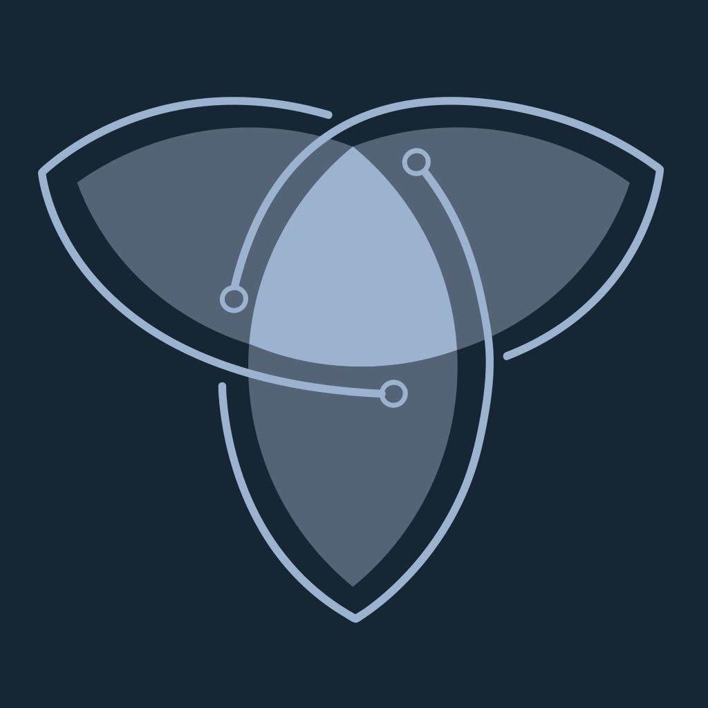
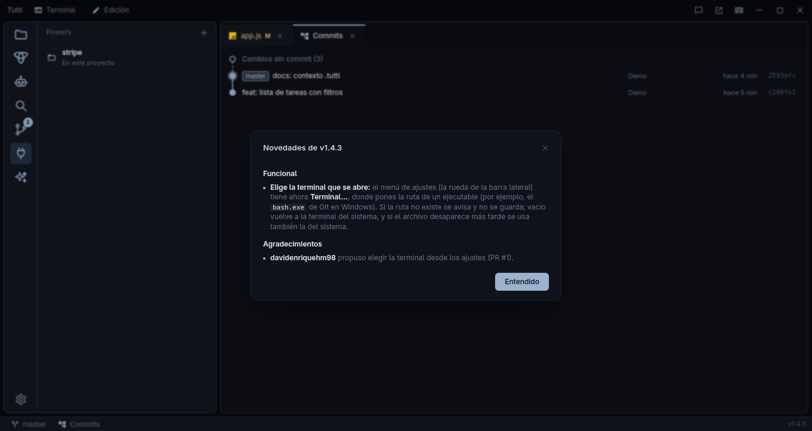
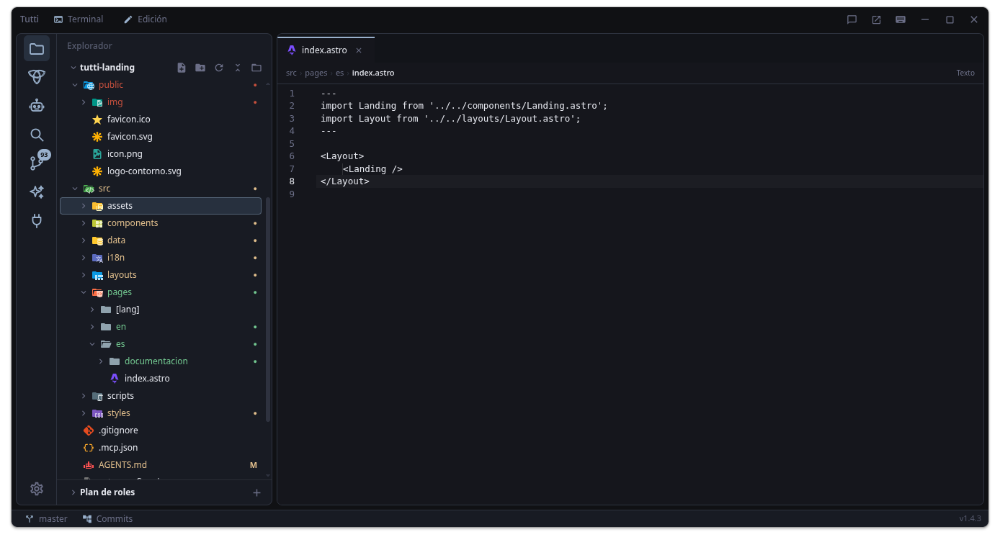

<div align="center">



# Tutti

### Forma tu orquesta de IA en la era de los agentes.

La IA y los agentes cambiaron la forma de programar. Tutti los reúne:<br />
Claude Code · OpenCode · Codex · Gemini CLI · Antigravity · y cualquier otro, cada uno con su instrumento, tocando juntos en una sola ventana.

[](https://github.com/cyansaju-sys/tutti/releases/latest)


<br />

[](https://github.com/cyansaju-sys/tutti/releases/latest)


[](https://github.com/cyansaju-sys/tutti/stargazers)

**[⬇ Instalar](#instalar)** &nbsp;·&nbsp; [Qué incluye](#qué-incluye) &nbsp;·&nbsp; [Atajos](#atajos) &nbsp;·&nbsp; [Desarrollo](#desarrollo) &nbsp;·&nbsp; [Privacidad](#privacidad)

<br />


<sub>Ejemplo real: un Claude Code (el líder) le pasa una tarea a OpenCode, que se abre en su propio panel marcado «sub de Claude Code» y le contesta; a la izquierda, la pestaña Tutti con la documentación, el roadmap y las specs del proyecto.</sub>

</div>

<br />

## Por qué Tutti

<table>
<tr>
<td width="33%" valign="top">

### 🎼 Que se coordinen
Un agente le **manda tareas a otro** y Tutti elige el más adecuado según la dificultad, su modelo y su límite de uso.

</td>
<td width="33%" valign="top">

### 🧰 Todo en la misma ventana
Terminales, **editor**, **git** con grafo de commits, **servidores MCP** y **consumo de tokens**. Sin saltar de herramienta.

</td>
<td width="33%" valign="top">

### 🔌 Sin atarte a nadie
Detecta más de 20 agentes y **añade el tuyo**. Tienda de **MCP** integrada, tema claro y oscuro, **español e inglés**.

</td>
</tr>
</table>

<br />

## Instalar

<table>
<tr>
<td width="50%" valign="top">

### Linux

```bash
curl -fsSL https://github.com/cyansaju-sys/tutti/releases/latest/download/install.sh | bash
```

Descarga el AppImage de la última release en `~/.local/share/tutti/`, crea el comando `tutti` y la entrada del menú de
aplicaciones. No hace falta ser administrador. Si falta `libfuse2` (Arch: `fuse2`) funciona igual, solo que abre más despacio.

El comando es `~/.local/bin/tutti`. Si descargas el AppImage a mano, se crea la primera vez que lo abres. La app lo mantiene
al día y, si ya tienes un `tutti` propio en esa ruta, no lo toca.

Para quitarla: `install.sh --uninstall` (tus ajustes en `~/.config/tutti` se conservan).

</td>
<td width="50%" valign="top">

### Windows

Descarga **`Tutti-Setup-X.Y.Z.exe`** de la [última release](https://github.com/cyansaju-sys/tutti/releases/latest) y ábrelo.
Se instala para tu usuario, sin permisos de administrador, crea el acceso directo y añade el comando `tutti` a tu PATH (lo
ven las terminales que abras después de instalar).

> El instalador no está firmado: Windows puede mostrar el aviso de SmartScreen. Pulsa
> **Más información → Ejecutar de todas formas**.

</td>
</tr>
</table>

**Desde la terminal**, en los dos sistemas: `tutti .` abre la carpeta actual como proyecto y `tutti ~/ruta/al/proyecto` abre
esa; con un archivo (`tutti src/main.ts`) se abre su repositorio git (o su carpeta, si no está en ninguno) y el archivo en el
editor. `tutti` a secas abre el último proyecto. La app se abre aparte y la terminal queda libre.

**Se actualiza sola.** Cuando sale una release nueva aparece un botón **Actualizar a vX.Y.Z** arriba a la derecha. Al pulsarlo
descarga la versión nueva, verifica su hash y la app se reinicia para aplicarla.


**Y te cuenta qué cambió.** La primera vez que abres la app tras actualizar sale un diálogo con las **novedades** de la versión (o de
todas las que te saltaste). Salen de [CHANGELOG.md](CHANGELOG.md) y puedes volver a verlas pulsando el número de versión junto al
nombre de la app.



> macOS llegará más adelante. El código de la versión anterior (Python) sigue en los tags `v0.1.x`.

<br />

## Qué incluye

### Archivos y editor

Árbol con los íconos de Material Icon Theme y la letra de git en lo que cambió. Los archivos se abren en pestañas, ya editables,
con colores, marcas de git en el margen (verde añadido, azul modificado, rojo borrado), autocompletado (`Enter` o `Tab` aceptan),
`Ctrl+S` para guardar y recarga automática si otra herramienta cambia el archivo. **Selecciona código y pulsa `Ctrl+L`** (o clic derecho → *Enviar selección al agente*) para escribir en el prompt del agente activo la referencia `@archivo:12-30` y el trozo, sin enviarlo. El permiso **Edición** de la barra de título
(o `Ctrl+Shift+L`) los deja en solo lectura. Con el árbol enfocado se navega con las flechas.

La cabecera del árbol tiene los botones **Nuevo archivo**, **Nueva carpeta**, **Actualizar**, **Contraer todo** y **Abrir otro
proyecto**; también puedes pulsar en un espacio vacío del árbol para crear algo en la raíz. El nombre se escribe en el propio
árbol, como en VS Code (`Enter` crea, `Esc` cancela).

**Cada proyecto recuerda lo suyo.** Al cambiar de proyecto se cierran sus agentes, terminales y archivos (si hay cambios sin
guardar, antes pregunta), y al volver a uno ya conocido se recupera la pestaña de la barra lateral y los archivos que tenías
abiertos. Los **tooltips** son propios y muestran el atajo de teclado como tecla.

Con **clic derecho** sobre un archivo o carpeta:

| Acción | Qué hace |
|---|---|
| **Enviar al agente** | Escribe la ruta (`@ruta` en los agentes que la entienden) en el prompt del agente activo, sin pulsar Enter |
| **Nuevo archivo / Nueva carpeta** | Los crea dentro de la carpeta con el campo de nombre en el árbol; el archivo se abre en el editor |
| **Renombrar** | En la propia fila, sin diálogo; las pestañas abiertas siguen el cambio de nombre |
| **Copiar ruta / ruta relativa** | Al portapapeles, sin avisos |
| **Borrar** | Pide confirmación y lo manda a la **papelera** (se puede recuperar) |

**Seleccionar varios y mover.** `Shift+↓/↑` amplía la selección, `Shift`+clic elige un rango y `Ctrl`+clic añade o quita una fila; con varias
seleccionadas, el clic derecho ofrece enviarlas al agente, copiar sus rutas o borrarlas (`Supr` también). **Arrastra** archivos o carpetas
sobre una carpeta para moverlos: Tutti pregunta antes, no pisa nada y las pestañas abiertas siguen al archivo. Las carpetas se tiñen
según lo que contienen: verde si solo hay archivos nuevos, ámbar si hay modificados.




#### Buscar y reemplazar

- **En el archivo abierto:** `Ctrl+F` abre un cuadro flotante arriba a la derecha del editor, con *distinguir mayúsculas*, *palabra
  completa* y *expresión regular*, el contador («3 de 12») y los botones anterior / siguiente. `Ctrl+H` añade la fila de reemplazo
  (*Reemplazar* y *Todo*). `Enter` / `Shift+Enter` recorren las coincidencias y `Esc` cierra.
- **En todo el proyecto:** el apartado **Buscar** de la barra lateral (`Ctrl+Shift+F`) agrupa los resultados por archivo y al pulsar
  uno se abre en esa línea, con la coincidencia seleccionada. *Filtros* admite globs separados por comas para incluir y excluir
  (`*.ts, src/**` · `*.test.ts, docs/`). Respeta el `.gitignore` si el proyecto usa git y salta binarios y archivos de más de 1 MB.
  Se corta a las 5000 coincidencias o 500 archivos (el contador muestra «+»).
- **Reemplazar en el proyecto:** `Ctrl+Shift+H` (o la flecha a la izquierda del campo) despliega el campo de reemplazo; se puede
  reemplazar por archivo o todo a la vez, pidiendo confirmación. Con expresión regular admite `$1`, `$&` y `$$`; conserva los fines
  de línea y **salta los archivos abiertos con cambios sin guardar** para no pisarlos.


### Agentes y terminal

`Ctrl+Shift+N` abre un agente de los instalados. Se buscan en el `PATH`, en el de tu shell de login y en las carpetas habituales,
así que funciona aunque lances la app desde el menú. `Ctrl+Shift+T` abre una shell en el proyecto como sección aparte, con varias terminales en una lista a la derecha.


- **Detecta los más habituales** —Claude Code, OpenCode, Codex, Gemini CLI, Aider, Cursor, Goose, Amp, Qwen Code, Copilot CLI,
  Droid, Kimi, Crush, Kilo, Cline, Plandex, Auggie, Forge, Mistral Vibe, Warp— con su logo.
- **Añade el tuyo** desde *Añadir otro agente…* (por ejemplo **Antigravity**, con el comando `agy`): escribes el comando (con
  argumentos si hace falta) o eliges uno de los ejecutables que la app encuentra en tus carpetas `bin`. Los propios que no tienen
  logo llevan una insignia generada con su inicial.
- Si un proceso no arranca o termina, un aviso lo explica.
- **Copiar y pegar** como en cualquier terminal moderna: `Ctrl+C` copia si hay texto seleccionado (si no, sigue siendo «interrumpir»), `Ctrl+V`, `Ctrl+Shift+V` y `Shift+Insert` pegan, y el **clic derecho** abre un menú con *Copiar*, *Pegar* y *Seleccionar todo*. Si el portapapeles no tiene texto (una captura, por ejemplo), `Ctrl+V` se lo deja al agente, que la lee él mismo.


Sin agentes abiertos, ese espacio es la **pantalla de inicio**: el botón *Elegir agente*, los atajos básicos y tus **proyectos
recientes** para volver a ellos con un clic (con *Abrir otro* para elegir una carpeta y una ✕ para quitar uno del historial). Si
abres un archivo sin agentes, el editor ocupa todo el espacio. La barra lateral se pliega a solo iconos con `Ctrl+Shift+B`, y con
doble clic en un icono.


#### Tema claro y oscuro · Español e inglés

La tuerca de abajo en la barra lateral abre los ajustes, con dos submenús que se abren al pasar el ratón:

- **Tema:** oscuro, claro (de tonos suaves, sin blanco puro, para no cansar la vista) o *Automático*, que sigue al del sistema. Cambia también el editor, los colores del código y las terminales.
- **Idioma:** *Español*, *Inglés* o *Automático*. Cambia toda la interfaz al instante y se recuerda al reabrir. El contexto del proyecto y el mensaje de commit con IA también se piden en tu idioma.

<table>
<tr>
<td width="50%"></td>
<td width="50%"></td>
</tr>
</table>


**Varias ventanas.** El botón de la barra de título (o *Nueva ventana vacía* en el menú del lanzador, con clic derecho sobre el
icono en Linux) abre otra ventana de Tutti **sin proyecto**: es otro proceso, con sus propios agentes, su servidor de tareas y su
proyecto. Los ajustes (`settings.json`) se comparten, así que lo último que abras en cualquier ventana es lo que se reabre al iniciar.

### Reparto de tareas

La app abre un servidor MCP local (solo `127.0.0.1`, con un token distinto en cada ejecución) y conecta a cada agente a él con las
herramientas `list_agents`, `delegate_task`, `wait_agent` y `read_agent_output`. Un agente puede mandar una tarea a otro abierto o
pedir uno nuevo —incluso del mismo tipo—, que sale en su propio editor marcado «sub de …».

**Asigna según la capacidad.** Si el agente pasa `difficulty` (`easy`, `medium`, `hard`), la app revisa la lista de agentes,
comprueba el nivel de su modelo (*basic*, *standard*, *advanced*) y su límite de uso, y elige el más adecuado: el justo para la
tarea (no gasta uno avanzado en algo fácil), libre antes que ocupado y que no tenga el límite agotado. Si el agente que se pide no
tiene capacidad suficiente, se rechaza y se propone otro (`force` lo mantiene).

Se desactiva con `"orchestration": false` en `~/.config/tutti/settings.json`. OpenCode 2.x atiende a todos sus clientes desde un
servicio compartido, así que a cada editor se le lanza con `--standalone`: su configuración no se mezcla con la de otros OpenCode.

**Codex** recibe la dirección y la clave de su sesión con `-c` y una variable de entorno, así que no se toca su `config.toml`.

**Antigravity** no admite configuración por proceso, así que Tutti registra en `~/.gemini/config/mcp_config.json` un servidor «tutti» (un pequeño puente que genera en `<config>/tutti/mcp-bridge.mjs`) y a cada panel le pasa por entorno la dirección y la clave de su sesión. Fuera de Tutti ese servidor no ofrece herramientas. Si Antigravity pide permiso la primera vez que usa una herramienta, apruébalo.

### Contexto del proyecto

El apartado **Contexto** (`Ctrl+Shift+K`) guarda un texto que **leen los agentes que abras**: qué es el proyecto, cómo se ejecuta,
convenciones y cómo prefieres trabajar. Se ve como **Markdown** (*Editar* o doble clic para modificarlo) y tiene dos capas:

- **Proyecto:** vive **en el repositorio** y en **un solo archivo**: el `AGENTS.md` del proyecto si ya lo tiene (el estándar que también
  leen Codex, OpenCode, Cursor y otros, y se edita ahí mismo, sin copias) o, si no, `.tutti/steering/contexto.md`. Se versiona con git y
  se comparte con el equipo. No se crea hasta que escribes y guardas. Los contextos de versiones anteriores (en la configuración de
  Tutti) se siguen usando hasta que los guardes en el proyecto.
- **Global:** tus preferencias para **todos** los proyectos, en `<config>/tutti/contexto-global.md` (nunca en un repositorio).

**AGENTS.md apuntando a `.tutti`.** En la pestaña Tutti, la fila **AGENTS.md** crea (o completa) el `AGENTS.md` del proyecto con un bloque marcado
(`<!-- tutti:start -->` … `<!-- tutti:end -->`) que lista lo que hay en `.tutti/` —steering, specs de `openspec/`, documentación y skills— y
dice a los agentes que lo consulten. Así cualquier agente que lea el estándar `AGENTS.md` (Codex, OpenCode, Cursor, Copilot…) sabe dónde mirar,
**también fuera de Tutti**. Es un puntero, no una copia: el contenido sigue en `.tutti/`. Al **crearlo**, un agente (el abierto o el que elijas) lo **rellena**: qué es el proyecto, los comandos exactos para instalar, ejecutar y probar, la estructura, las convenciones y lo que no debe hacer, siempre encima del bloque, y **remitiendo por su ruta a lo que ya está en `.tutti/`** (steering, documentación, specs, skills) en vez de copiarlo; si ya existía y no tiene texto propio, el botón **Rellenar con el agente** hace lo mismo. Solo toca su bloque (el resto del archivo es tuyo),
avisa cuando la lista se queda desactualizada, y un `AGENTS.md` que solo tiene el bloque no cuenta como contexto propio (ese va en
`.tutti/steering/contexto.md`). El bloque no se entrega repetido a los agentes que abres desde Tutti. Se puede quitar con un botón.

Al abrir un agente desde Tutti recibe primero el global y luego el del proyecto: Claude Code como parte de su prompt de sistema y
OpenCode como archivos de instrucciones. Funciona también si el agente se abre en una subcarpeta y sin el reparto de tareas.

**Generar con IA** lo redacta un agente a partir de un resumen pequeño del proyecto (estructura, `package.json`, inicio del README,
últimos commits), sin dejarle explorar, para gastar muy pocos tokens: con Claude usa el modelo pequeño `haiku`, y si ningún agente
responde arma un borrador con reglas. Al cambiar de apartado se cancela.

Bajo el editor, el panel **Lo que reciben los agentes** muestra de dónde sale cada parte y cuánto pesa en tokens aproximados (avisa si
pasa de unos 3 000). Los archivos de `.tutti/steering/` siguen el steering de Kiro: una cabecera opcional dice cuándo se entregan
(`inclusion: always` por defecto, `fileMatch` con `fileMatchPattern`, `manual` o `auto` con `name` y `description`); las guías que no van enteras
se listan con su ruta, y `#[[file:ruta]]` dentro del texto se sustituye por el archivo real. El **+** de Steering crea uno con sus modos o los
tres archivos base (`product.md`, `tech.md` y `structure.md`).


### La pestaña Tutti y la carpeta .tutti

La pestaña **Tutti** (`Ctrl+Shift+J`) reúne en un sitio lo que los agentes necesitan saber de tu proyecto: **documentación, roadmap, specs, hooks, steering, skills** y los servidores MCP instalados. Todo vive en `.tutti/`, una carpeta que Tutti crea en cada proyecto que abres (con un `README.md`); es texto plano, se versiona con git y la comparte el equipo. Las **subcarpetas solo aparecen cuando añades algo**.

```
.tutti/
├─ roadmap.md  el plan por fases, cada una con sus specs
├─ specs/      una carpeta por función o error: requirements.md (EARS) o bugfix.md, design.md y tasks.md (casillas, con su avance)
├─ docs/       documentación por categorías (Diátaxis: tutorials, how-to, reference, explanation)
├─ steering/   contexto.md y tus guías para los agentes (product.md, tech.md…)
├─ hooks/      un .json por hook, en el formato de Kiro
└─ skills/     una carpeta por skill, con su SKILL.md
```

Cada sección tiene su **+** y, si está vacía, un botón de ancho completo para crear el primer elemento. Crear una spec, un hook o un steering abre un **formulario como una pestaña del editor**.

- **Roadmap**: el plan completo del proyecto por fases, cada una con varias specs. Es `.tutti/roadmap.md` (o, si no existe, el `ROADMAP.md` de la raíz): cada `##` es una fase y cada viñeta un ítem; si empieza con `` `nombre` ``, se vincula al cambio de OpenSpec con ese nombre. Tutti muestra cada fase con su avance, abre la actual y marca la **siguiente** tarea: un ítem está **hecho** si tiene `[x]` o su cambio se archivó, **en marcha** si su cambio existe (con sus tareas `n/m`), **sin spec** si aún no lo tiene y **sin verificar** si es una viñeta suelta. El botón **¿Dónde nos quedamos?** le pide al agente que lea el roadmap, las tareas y git, compruebe en el código qué está hecho de verdad y te proponga los siguientes pasos, sin tocar nada hasta que lo apruebes. Desde un ítem sin spec, el botón de la derecha abre el formulario de spec ya rellenado, y al **archivar** un cambio su casilla se marca sola. Si no hay roadmap, se crea con una plantilla o lo **redacta el agente** explorando el proyecto. AGENTS.md también apunta a él, así que funciona fuera de Tutti.
- **Specs** (flujo de Kiro): ¿funcionalidad o error?, qué quieres y, si es una funcionalidad, ¿requisitos o diseño primero? Un error crea `bugfix.md` (actual, esperado, sin regresiones). Puedes empezar con plantillas o **pedírselo al agente abierto**: trabaja por fases y espera tu aprobación entre una y otra (o, con el flujo **Rápida**, los tres archivos de una vez). En la barra del editor de cada archivo de la spec, el agente puede **analizar** los requisitos, **actualizar** el diseño y las tareas cuando los cambias y **ejecutar las tareas** (la siguiente o todas).
- **Steering** (modos de Kiro): `always` (por defecto), `fileMatch` + `fileMatchPattern`, `manual` o `auto` con `name` y `description`; lo que no va entero se lista con su ruta. `#[[file:ruta]]` y `#[[folder:ruta]]` dentro del texto se sustituyen por el contenido real. `fileMatch` mira los archivos con cambios en git y los abiertos en el editor, y puedes crear steering **globales** (para todos tus proyectos, fuera del repositorio). Crea de golpe `product.md`, `tech.md` y `structure.md` y el agente puede rellenarlos.
- **Hooks** (formato de Kiro): `PostFileSave` ejecuta un comando (con el archivo en `$TUTTI_HOOK_FILE` y el contexto por stdin) o le escribe un prompt al agente; el **+** ofrece un formulario guiado o describírselo al agente, y se editan con el mismo formulario. `PreToolUse`, `PostToolUse` y `Stop` se muestran pero no se ejecutan. **No corren hasta que pulsas «Permitir hooks en este proyecto»**, porque ejecutan comandos del repositorio.
- **Skills**: el formulario pide el nombre, qué hace y cuándo usarla (la descripción por la que el agente la elige) y las instrucciones; también puede redactarlas el agente, y puedes importar una skill que ya tengas.
- **Documentación**: solo se ven las categorías con documentos; al crear uno eliges la categoría.

Los `.md` tienen un botón **Vista / Código** en el editor; los de `.tutti` se abren ya renderizados, con las casillas de `tasks.md`. En el Explorador, la carpeta lleva el logo de Tutti.


<table>
<tr>
<td width="33%"></td>
<td width="33%"></td>
<td width="33%"></td>
</tr>
</table>

### Servidores MCP

Lee, añade, edita y quita los servidores de **Claude Code, OpenCode, Gemini CLI, Qwen Code, Cursor Agent, Codex y Antigravity** (globales, del proyecto y
`.mcp.json`) usando la CLI de cada agente (Cursor Agent no tiene `mcp add`: se escribe su `.cursor/mcp.json`). En la lista, **cada servidor es una sola tarjeta**: al abrirla ves en qué agentes está
aplicado, con sus datos (los secretos ocultos hasta que lo pides), y puedes copiarlo a otro o **quitarlo** (la papelera de la lista o *Quitar* en su ficha). Si está en `.mcp.json`, se quita de ahí y Antigravity y Codex lo pierden con él.
Al **añadir o editar** un servidor del proyecto, Tutti solo toca `.mcp.json`, y **Antigravity y Codex lo siguen solos** con un espejo:
Antigravity, que no tiene archivo de MCP por proyecto, por un plugin, `.tutti/plugins/tutti-mcp/`, que Tutti declara en `.agents/plugins.json`;
Codex, por el `.codex/config.toml` del proyecto (lo lee si el proyecto es de confianza). En los dos, los servidores locales arrancan con
`.tutti/mcp/launch.mjs`, que lee `.mcp.json` en cada arranque, y los remotos van con su URL. Gemini CLI, Qwen Code y Cursor Agent se ponen al día con **Añadir lo que falta**. Las secciones se pliegan y tienen su propio scroll.

**Gestionar los servidores.** Al abrir uno: **Probar** lo arranca (o llama a su URL) como lo haría un agente y muestra si conecta, cuánto tarda y sus herramientas; **Editar** cambia su comando, URL, argumentos, variables o cabeceras en todos los agentes donde está (si el cambio falla, deja el anterior); y el interruptor de cada agente lo **desactiva** sin perder su configuración —Tutti lo quita del agente y la guarda en sus ajustes, no en el proyecto— para volver a **activarlo** cuando quieras.

**Sincronizar entre agentes.** Sin inventar otro formato: la fuente es **Claude Code** —el `.mcp.json` del proyecto y sus MCP de usuario para los globales— y Tutti compara con ella cada agente instalado (OpenCode, Gemini CLI, Qwen Code, Cursor Agent, Antigravity y Codex). No hay una sección aparte: **en la lista de instalados, cada servidor dice bajo su nombre en qué agente *falta*, es *distinto* o está *desactivado*** (y ahí mismo se resuelve un desfase), y las acciones van al final de la lista. **Añadir lo que falta** (siempre visible, desactivado si no hay nada que copiar) lo copia, **Estandarizar los N MCP locales** (en el proyecto) pasa a `.mcp.json` los locales de Claude y los que solo están en otros agentes —salvo los que llevan claves o tokens, porque `.mcp.json` se versiona—, y quita de `opencode.json` los que ya están igual allí (si el archivo solo tenía MCP, lo borra; si tiene más ajustes, los conserva): **OpenCode recibe los de `.mcp.json` al abrirlo desde Tutti**, así que no hace falta ese archivo. **Traer N de otros agentes** (global) pasa a la fuente lo que solo existe en otro, y un desfase se resuelve con **Usar el de Claude** o **Usar el del agente**. Tutti no crea ningún archivo propio: solo usa los de cada agente (en Antigravity, el plugin del proyecto con su formato).

<table>
<tr>
<td width="50%"></td>
<td width="50%"></td>
</tr>
</table>

#### Tienda de servidores

Busca en el **registro oficial de MCP** sin salir de la app, con el aspecto de las extensiones de VS Code: una lista con icono, nombre,
descripción, quién lo publica y el botón **Instalar**. Los más conocidos (Context7, Playwright, GitHub, Notion, Figma…) salen primero,
en **Recomendados**.

1. Al pulsar un servidor se abre su **ficha**: qué es, quién lo publica, el comando exacto que se va a ejecutar y lo que pide rellenar.
2. *Continuar* abre el diálogo de **Añadir servidor** ya relleno; completas lo que falte y eliges a qué agentes va.

Solo se ofrece lo que Tutti sabe instalar: paquetes npm (con `npx`), pypi (con `uvx`) y servidores remotos por URL. Instalar un MCP
ejecuta código de terceros que el registro no revisa, y la ficha lo recuerda.

<table>
<tr>
<td width="33%"></td>
<td width="33%"></td>
<td width="33%"></td>
</tr>
</table>

### Consumo e historial

Tokens de la ventana de 5 h de Claude, de hoy, de 7 días y totales; los porcentajes reales de límite que da Anthropic (se consultan
una vez al abrir la pestaña, con la sesión de Claude Code); el consumo de OpenCode; y el historial del proyecto, donde puedes
retomar, renombrar o borrar una sesión. De **Codex** se leen tokens, límite del plan e historial de sus registros locales (`~/.codex`), y de **Antigravity** el historial de conversaciones (no guarda tokens en local).

### Git


- **Cambios** con preparar / quitar, y secciones *preparados* y *cambios* que se pliegan.
- **Mensaje de commit con IA.** La ✨ del campo de commit le pide a un agente instalado un mensaje en
  [Conventional Commits](https://www.conventionalcommits.org), a partir de **lo que tienes preparado**, y lo deja en el campo para
  que lo revises. Se ve qué agente lo redacta. Si ninguno responde, se arma con reglas sencillas sobre los archivos tocados.
- **Un solo botón, un paso por pulsación.** Con mensaje hace *Commit*; después pasa a *Push* o, si faltan cambios del remoto, a
  *Pull* (solo avance simple, nunca une a ciegas), con una animación del progreso. Sin repositorio remoto solo ofrece commit.
- **Ramas** (`Ctrl+Shift+G` o el chip de la barra de título): un selector al estilo de VS Code con la fecha y el último commit de cada
  rama, búsqueda, cambio de rama, **crear** una nueva (desde la actual o *a partir de…* otra) y *desproteger* para ir a una rama o
  commit sin crear rama. Funciona también en un repositorio recién creado, sin commits.


#### Comparar cambios

Al pulsar un archivo de la sección Git se abre una pestaña con la **comparación en dos columnas** (lo anterior a la izquierda, lo
nuevo a la derecha), con líneas añadidas y borradas resaltadas y los tramos largos sin cambios plegados.


#### Commits

El chip **Commits** de la barra de título abre el **grafo de todas las ramas**, con las etiquetas de rama, remota y tag, los
merges atenuados y una fila de *cambios sin commit* que lleva a la sección Git.

- **Clic en un commit** → debajo salen sus datos y los **archivos que cambió** con `+N −N`; en un merge, lo que trajo la rama unida.
  Al pulsar un archivo se abre su comparación.
- **Clic derecho** → etiqueta, crear rama aquí, cambiar de rama (local o remota), cherry-pick, revertir, unir (con *no-ff*,
  *squash* y *no commit*), rebase, reset (suave, mixto o duro) y copiar hash o mensaje. Las operaciones que cambian el historial
  piden confirmación, y si dan conflictos se cancelan sin dejar el repositorio a medias.


<br />

## Atajos

`F1` muestra la lista completa dentro de la app.

| Atajo | Acción |
|---|---|
| `Ctrl+S` / `Ctrl+W` | Guardar / cerrar el archivo abierto |
| `Ctrl+L` | Enviar la selección (o la línea) al agente activo |
| `Ctrl+Shift+F` / `Ctrl+Shift+H` | Buscar / buscar y reemplazar en el proyecto |
| `Ctrl+F` / `Ctrl+H` | Buscar / reemplazar en el archivo abierto |
| `Ctrl+Shift+L` | Permitir o bloquear la edición |
| `Ctrl+Shift+N` | Abrir un agente |
| `Ctrl+Shift+T` | Mostrar u ocultar la terminal |
| `Ctrl+Shift+W` | Cerrar el editor activo |
| `Ctrl+AvPág` / `Ctrl+RePág` | Editor siguiente / anterior |
| `Ctrl+Shift+B` | Mostrar u ocultar la barra lateral |
| `Ctrl+C` / `Ctrl+V` | En terminales y agentes: copiar (con texto seleccionado) / pegar. También `Ctrl+Shift+C`, `Ctrl+Shift+V` y `Shift+Insert` |
| `Ctrl+Shift+E` · `F` · `A` · `G` · `J` · `K` · `X` · `U` | Archivos · Buscar · Agentes · Git · Tutti · Contexto · MCP · Consumo |
| `Ctrl+Q` | Cerrar la aplicación |


<br />

## Desarrollo

```bash
yarn install         # instala y recompila node-pty y better-sqlite3 para Electron
yarn dev              # con recarga en caliente (la interfaz se actualiza al guardar; main y preload reinician la app)
yarn test            # pruebas unitarias (vitest)
yarn typecheck
yarn dist             # empaqueta el AppImage en release/
yarn dist:win         # empaqueta el instalador de Windows (hay que ejecutarlo en Windows)
```

Si tu terminal define `ELECTRON_RUN_AS_NODE` (algunos editores lo hacen), `yarn dev` ya la quita por ti.

```
src/
  main/        proceso principal
    services/     la lógica, una carpeta por tema (agents, git, context, usage, mcp, files, search, settings, updater)
    utils/       idioma de los mensajes, versión, ruta del shell, autotest
  preload/     el puente seguro hacia la interfaz (window.api)
  renderer/    interfaz en React + Tailwind (features/ por tema, shared/ y estado con zustand)
  shared/      tipos compartidos
test/          pruebas (vitest) en test/main y test/renderer, y capture.ts, el modo de capturas
resources/     ícono de la app
scripts/       dev.mjs
```

<details>
<summary><b>Herramientas de depuración</b></summary>

<br />

Todas por variable de entorno:

| Variable | Qué hace |
|---|---|
| `TUTTI_MCP_LOG=1` | Imprime cada petición que reciben los servidores MCP |
| `TUTTI_CAPTURE=<carpeta>` | Abre la app con ajustes aislados, recorre las pantallas y guarda una captura de cada una (así se hicieron las de este README) |
| `TUTTI_CAPTURE_NEW=1` | Con la captura, añade el inicio sin agentes, el contexto del proyecto y las novedades |
| `TUTTI_CAPTURE_TUTTI=1` | Con la captura, añade la pestaña Tutti y un `.md` en vista, con un proyecto de ejemplo temporal (no escribe en el tuyo) |
| `TUTTI_CAPTURE_GRAPH=1` · `TUTTI_CAPTURE_DIFF=<archivo>` | Con la captura, añade el grafo de commits y la comparación de un archivo modificado |
| `TUTTI_CAPTURE_INTERNAL=1` | Con la captura, coloca la ventana en la pantalla integrada (si hay varias) y ocupando su área útil |
| `TUTTI_CAPTURE_LANG=en` · `TUTTI_CAPTURE_LIGHT=1` | Con la captura, saca las imágenes en inglés (`es` / `en`) o con el tema claro |
| `TUTTI_CAPTURE_MCP=1` · `TUTTI_CAPTURE_UPDATE=1` | Con la captura, añade los servidores MCP (incluida la tienda, que consulta el registro) y el botón de actualización |
| `TUTTI_CAPTURE_REAL=1` | Con la captura, lanza **agentes reales** (Claude Code) en una carpeta de ejemplo temporal para la imagen principal; gasta tokens de tu cuenta |
| `TUTTI_SELFTEST=1` | Prueba el reparto de tareas de punta a punta con agentes falsos |

</details>

<details>
<summary><b>Publicar una release</b></summary>

<br />

1. Sube `version` en `package.json` (p. ej. `1.0.2`), añade su sección `## 1.0.2` a `CHANGELOG.md` (lo que verán los usuarios) y haz commit.
2. `git tag v1.0.2 && git push origin master v1.0.2`.

GitHub Actions comprueba que el tag coincide con la versión y que el changelog la menciona, pasa tipos y pruebas, empaqueta el AppImage (Linux) y el instalador
(Windows) y crea la release con `Tutti-X.Y.Z-x86_64.AppImage`, `latest-linux.yml`, `install.sh`, `Tutti-Setup-X.Y.Z.exe` y
`latest.yml` (lo que lee el actualizador). Si el build de Windows falla, la de Linux sale igual. Las instalaciones existentes ven el
botón **Actualizar** al cabo de unos minutos.

</details>

<br />

## Contribuir

Tutti es de código abierto y cualquier ayuda suma: errores bien descritos, traducciones, documentación o código. Lee la [guía para colaborar](CONTRIBUTING.md) (reglas del código, textos en español e inglés, commits y pull requests) y el [código de conducta](CODE_OF_CONDUCT.md). Si te gusta, **una ⭐ en GitHub** ayuda a que más gente lo encuentre.

<br />

## Privacidad

Solo lectura sobre los datos de los agentes: los registros de Claude Code (`~/.claude/projects`), su configuración MCP
(`~/.claude.json`), la base de OpenCode (`~/.local/share/opencode`) y el historial de Antigravity (`~/.gemini/antigravity-cli`) y los registros de Codex (`~/.codex/sessions`).

La app solo sale a internet para consultar tus límites en Anthropic (con la sesión de Claude Code) y para buscar actualizaciones en
GitHub. El servidor de reparto de tareas escucha únicamente en `127.0.0.1`.

<div align="center">

<br />

<sub>Hecho con Electron, React, TypeScript y Tailwind, y con la ayuda de [Claude](https://claude.com/claude-code) (Anthropic) · MIT</sub>

</div>
