# Tutti documentation

Installation, editor, agents, task distribution, MCP, git, shortcuts, settings and development. The images are in [`img/`](img). · [Español](documentacion.md)

## Contents

- [Install](#instalar)
- [First steps](#primeros-pasos)
- [Files and editor](#archivos)
- [Find and replace](#buscar)
- [Agents and terminals](#agentes)
- [Task delegation](#reparto)
- [Project context](#contexto)
- [The Tutti tab](#tutti)
- [The .tutti folder](#dottutti)
- [MCP servers and store](#mcp)
- [Usage and history](#consumo)
- [Git](#git)
- [Appearance and language](#apariencia)
- [Keyboard shortcuts](#atajos)
- [Settings and files](#ajustes)
- [Privacy and security](#privacidad)
- [Troubleshooting](#problemas)
- [Development](#desarrollo)
- [Contributing](#contribuir)

<a id="instalar"></a>

## Install

Tutti is a desktop app for **Linux** and **Windows** (macOS is coming later). It does not need administrator rights.

### Linux

```
curl -fsSL https://github.com/cyansaju-sys/tutti/releases/latest/download/install.sh | bash
```

It downloads the AppImage of the latest release to `~/.local/share/tutti/`, creates the `tutti` command in `~/.local/bin` and the application menu entry. If `libfuse2` is missing (on Arch, `fuse2`) it still works, it just opens more slowly.

| Command | What it does |
|---|---|
| `install.sh` | Installs or reinstalls the latest version |
| `install.sh --version 1.0.9` | Installs a specific version |
| `install.sh --uninstall` | Removes it (your settings in `~/.config/tutti` are kept) |

Variables: `TUTTI_HOME` (where the AppImage is stored) and `TUTTI_REPO` (user/repository).

### Windows

Download **Tutti-Setup-X.Y.Z.exe** from the [latest release](https://github.com/cyansaju-sys/tutti/releases/latest) and open it. It installs for your user, creates the shortcut and adds the `tutti` command to your `PATH`.

> [!NOTE]
> The installer is not signed: Windows may show the SmartScreen warning. Click **More info → Run anyway**.

### Opening from the terminal

The `tutti` command opens the app with a project, like `code .` in VS Code. The app opens on its own and the terminal stays free.

| Command | What it opens |
|---|---|
| `tutti` | The last project |
| `tutti .` | The current folder as the project |
| `tutti ~/path/to/project` | That folder as the project |
| `tutti src/main.ts` | The file's git repository (or its folder, if it is not in one) and the file in the editor |
| `tutti --new-window` | An empty window, with no project |

Each `tutti` opens a new window, with its own agents. The folder becomes the last project and goes into the recent ones; if you had opened it before, its tab and files come back. If the path does not exist, the command says so and opens nothing.

On **Linux** the command is `~/.local/bin/tutti`: `install.sh` creates it and, if you downloaded the AppImage by hand, the app itself does the first time you open it. The app keeps it up to date (for example, if you move the AppImage) and leaves alone a `tutti` that is not its own. On **Windows** the installer adds `resources\bin` (the folder with `tutti.cmd`) to your user's `PATH` and removes it when uninstalling; terminals you open after installing see it.

### Updates

The app updates itself. When a new release comes out, the **Update to vX.Y.Z** button appears at the top right: clicking it downloads the version, verifies its hash and restarts to apply it. The first time you open the app after updating, a dialog tells you what is **new** (or what changed in every version you skipped); you can see it again by clicking the version number next to the app name.

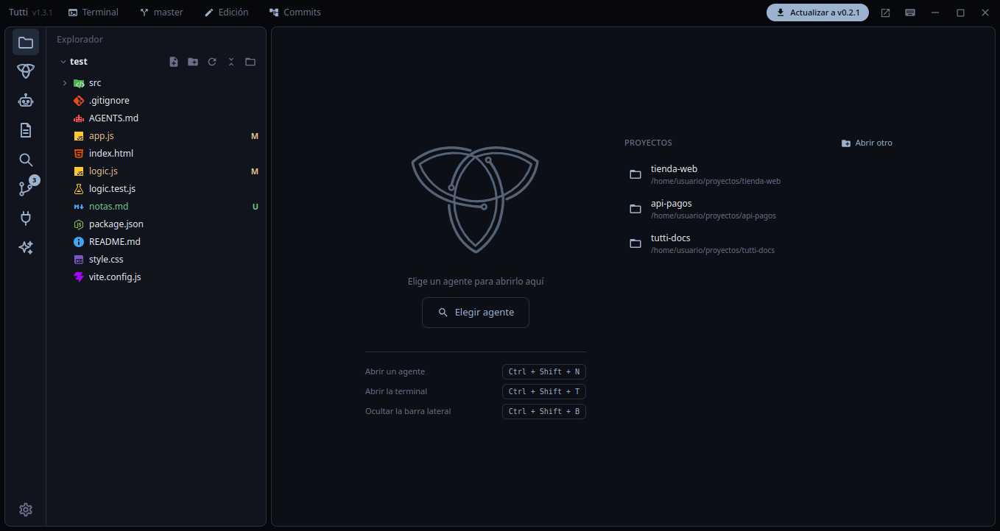

<a id="primeros-pasos"></a>

## First steps

1. **Open a project.** If there is none, the file tree asks for one; you can also pick one of the *recent projects* on the start screen or use the *Open another project* button in the tree header.
2. **Open an agent** with `Ctrl`+`Shift`+`N`. The ones Tutti found installed appear; type to filter and press `Enter`.
3. **Work as usual.** Each agent is its own terminal inside the window. You can open several, and also edit files, look at git or add MCP servers while they work.

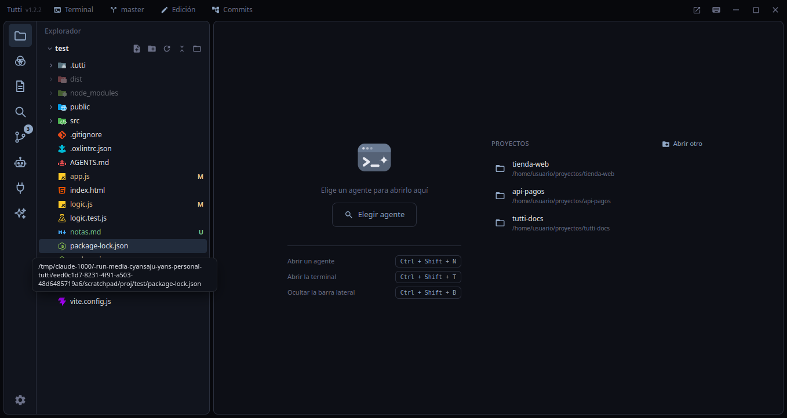

With no agents open, the central area is the **start screen**: the *Choose agent* button, the basic shortcuts and your recent projects (with *Open another* and an ✕ to remove one from the history). If you open a file with no agents, the editor takes all the space. `F1` shows the full list of shortcuts.

### The window

| Area | What it contains |
|---|---|
| Title bar | Terminal, current branch, edit permission, commits, version, update button, new window and shortcuts |
| Sidebar | Files, Search, Agents, Git, Context, MCP and Usage; at the bottom, the settings gear |
| Center | Tabbed editor on the left and the agents in a grid on the right |
| Bottom panel | The terminals, with their list on the right when there are several |

The sidebar folds to icons only with `Ctrl`+`Shift`+`B` or by double-clicking an icon. Dividers can be dragged to resize.

<a id="archivos"></a>

## Files and editor

The tree uses *Material Icon Theme* icons and shows the git letter next to what changed (`M` modified, `A`/`U` new, `D` deleted). Files open in tabs, **already editable**, with colors, git marks in the gutter (green added, blue modified, red deleted), autocomplete and automatic reload if another tool changes the file and there are no unsaved changes here.

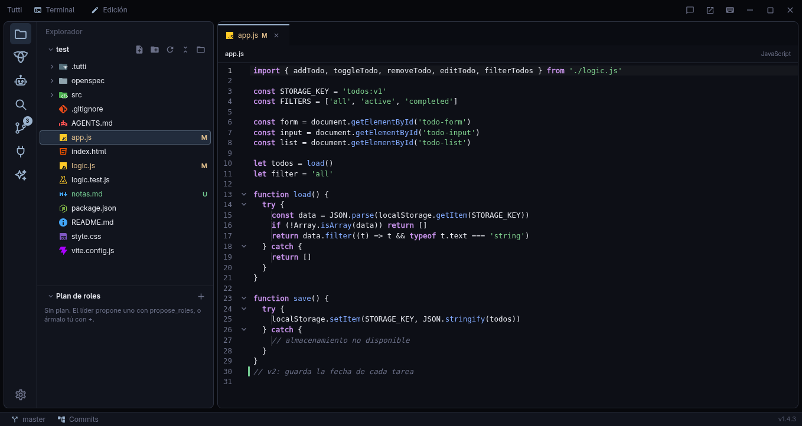

### Editing

- `Ctrl`+`S` saves; `Ctrl`+`W` closes the tab (it asks if there are unsaved changes).
- The **Editing** permission in the title bar (or `Ctrl`+`Shift`+`L`) makes files read-only. Files larger than 1 MB or not in UTF-8 always open read-only.
- **Send to agent:** select code and press `Ctrl`+`L` (or right click → *Send selection to agent*) to type the reference `@file:12-30` and the snippet in a code block into the active agent's prompt, **without sending it**: you keep typing your request. With no selection it sends the cursor's line; if the snippet is over 200 lines, only the reference goes.
- Autocomplete with `Ctrl`+`Space`; `Enter` or `Tab` accept and `Esc` closes the suggestion.
- Syntax highlighting for JavaScript/TypeScript (and JSX), Python, SQL, JSON, CSS, HTML, Markdown, XML, Vue and more.

### The tree

The header has the buttons **New file**, **New folder**, **Refresh**, **Collapse all** and **Open another project**. You can also click an empty space to create something at the root. The name is typed in the tree itself: `Enter` creates and `Esc` cancels. With the tree focused you can navigate with the arrows (→ opens, ← closes or goes up, `Enter` opens) and the marked row follows the mouse.

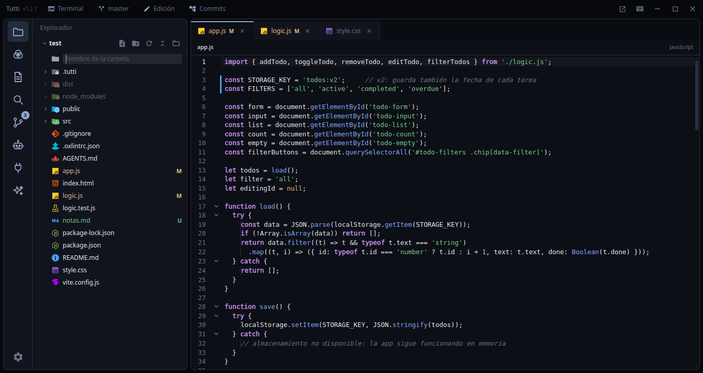

### Right click (or the menu key)

| Action | What it does |
|---|---|
| Send to agent | Types the path into the active agent's prompt (`@path` for the ones that understand it), without pressing Enter |
| New file / New folder | Creates them inside the folder; the file opens in the editor |
| Cut / Copy / Paste | Also with `Ctrl`+`X`, `Ctrl`+`C` and `Ctrl`+`V`. Pasting on a file does it in its folder; if the name already exists, the copy is named “name (2)” and nothing is overwritten. Cutting moves it and open tabs follow the file |
| Rename | Open tabs follow the rename |
| Copy path / relative path | To the clipboard |
| Delete | Asks for confirmation and sends it to the **trash** (recoverable) |

### Selecting several and moving

- `Shift`+`↓`/`↑` extends the selection; `Shift`+click selects a range and `Ctrl`+click adds or removes a row. With several selected, right click offers sending them to the agent, copying their paths or deleting them (`Del` too).
- **Drag** files or folders onto a folder (or onto the empty space, for the root) to move them. Tutti asks before moving, never overwrites anything that exists and does not let you put a folder inside itself; open tabs follow the file.
- Folders are tinted by what they hold: **green** if only new files, **amber** if any are modified, red if only deleted. Renaming happens on the row itself, with no dialog.

### When an agent changes an open file

Tutti detects it and marks the old lines (red) and the new ones (green) in the editor; a panel at the top lists each chunk, with *Accept* and *Undo* per chunk and for all. What you accept stays as an unsaved local modification for you to review. While you decide, the file is read-only.

### Languages

Highlighting for JavaScript/TypeScript, Python, SQL, JSON, CSS, HTML/XML, Markdown, Rust, Go, Java, C/C++, PHP, shell, YAML and TOML. Autocomplete and folding use Material icons; `Ctrl` + wheel (or `Ctrl` + `+` / `-`) changes the zoom.

### Each project remembers its own

Switching project closes its agents, terminals and files (if there are unsaved changes, it asks first). Returning to a known project restores the sidebar tab and the files you had open.

<a id="buscar"></a>

## Find and replace

### In the open file

`Ctrl`+`F` opens a floating box at the top right of the editor with *match case* (`Aa`), *whole word* (`ab`) and *regular expression* (`.*`), the counter (“3 of 12”) and the previous / next buttons. `Ctrl`+`H` adds the replace row (*Replace* and *All*). `Enter` / `Shift`+`Enter` go through the matches and `Esc` closes it.

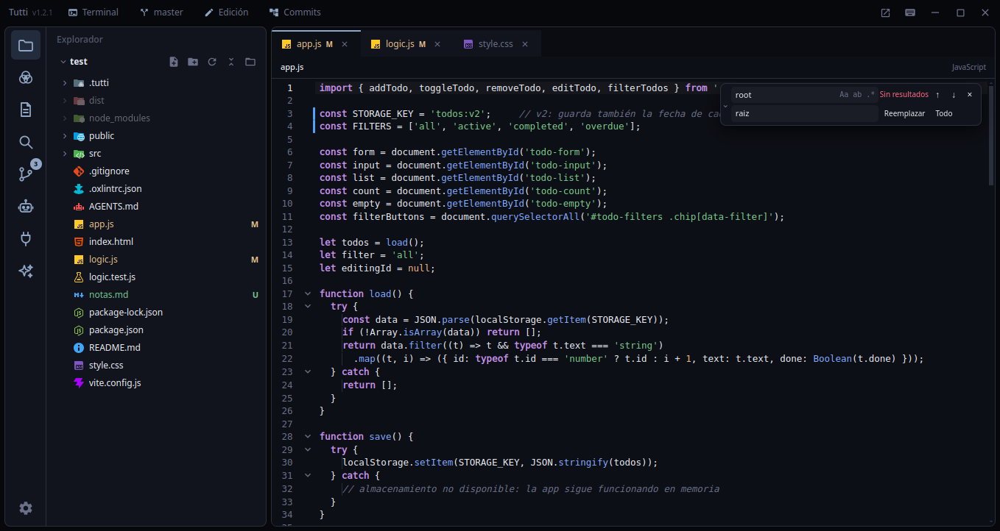

### Across the project

The **Search** section of the sidebar (`Ctrl`+`Shift`+`F`) groups results by file; clicking one opens it at that line with the match selected.

- **Filters** accepts comma-separated globs to include and exclude: `*.ts, src/**` · `*.test.ts, docs/`.
- It respects `.gitignore` if the project uses git, and skips binaries and files larger than 1 MB.
- It stops at 5000 matches or 500 files (the counter shows “+”).

### Replace across the project

`Ctrl`+`Shift`+`H` (or the arrow to the left of the field) shows the replace field. You can replace per file or all at once, always asking for confirmation. With a regular expression it supports `$1`, `$&` and `$$`; it keeps line endings and **skips open files with unsaved changes** so it never overwrites them.

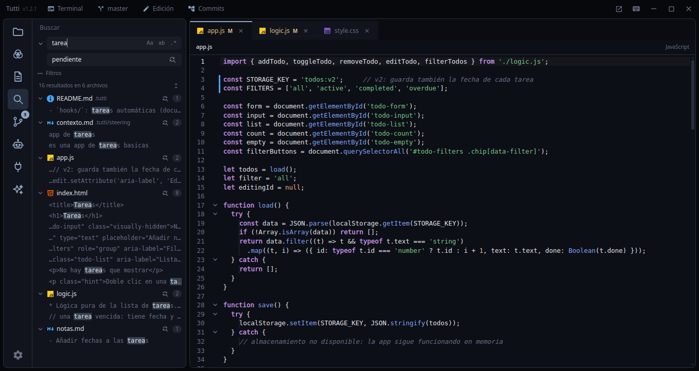

<a id="agentes"></a>

## Agents and terminals

`Ctrl`+`Shift`+`N` opens an installed agent. Tutti looks for them in the `PATH`, in your login shell's one and in the usual folders, so it works even if you launch the app from the menu. `Ctrl`+`Shift`+`T` opens a shell in the project as a separate section, with several terminals in a list on the right.

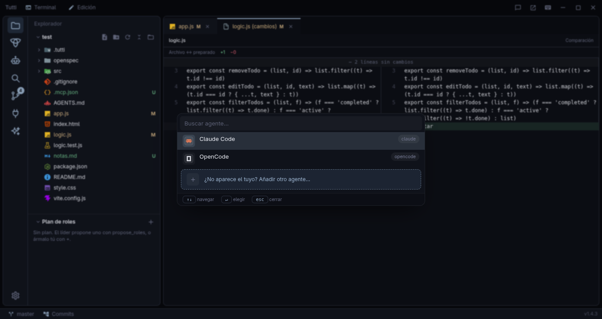

### Agents it detects

Claude Code, OpenCode, Codex, Gemini CLI, Aider, Cursor, Goose, Amp, Qwen Code, Copilot CLI, Droid, Kimi, Crush, Kilo, Cline, Plandex, Auggie, Forge, Mistral Vibe and Warp, each with its logo. Antigravity (`agy`) is added by hand.

### Add your own

In *Not listed? Add another agent…* you type a name and the command (with arguments if needed), or pick one of the executables the app finds in your `bin` folders. Custom ones without a logo get a badge generated from their initial. They are removed from the agents list.

### Terminals

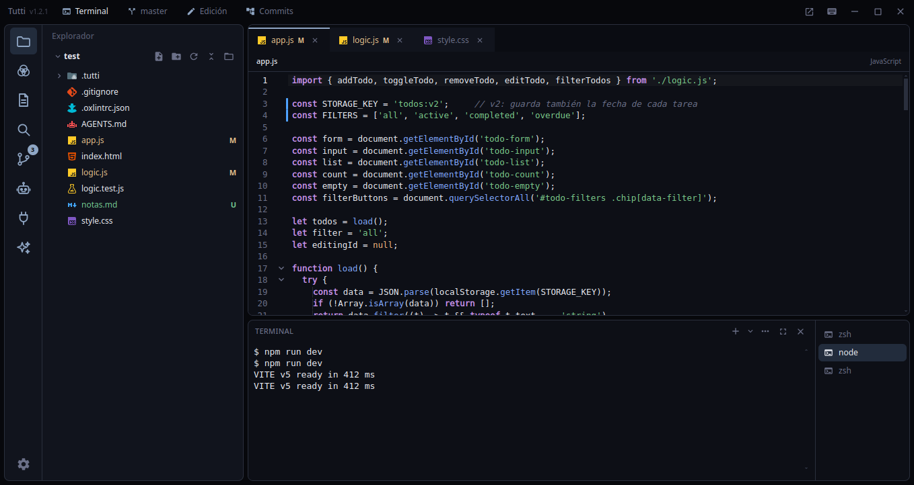

- Several terminals at once, in a list on the right of the panel; the panel can be maximized and closed as a whole.
- If a process does not start or ends, a notice explains it (command not found, signal, exit code).
- With several agents, they are laid out in a grid and `Ctrl`+`Page Down` / `Page Up` jumps between them.

### Copy and paste

| Shortcut | What it does |
|---|---|
| `Ctrl`+`C` | Copies if text is selected; otherwise it is still “interrupt” |
| `Ctrl`+`Shift`+`C` | Always copies |
| `Ctrl`+`V`, `Ctrl`+`Shift`+`V`, `Shift`+`Insert` | Paste the clipboard text (multi-line included) |
| Right click | Menu with *Copy*, *Paste* and *Select all* |

If the clipboard has no text (a screenshot, for example), `Ctrl`+`V` is left to the agent, which reads it itself.

### Several windows

The title bar button (or *New empty window* in the launcher menu, right-clicking the icon on Linux) opens another window **with no project**. It is another process, with its own agents, its own task server and its own project. Settings are shared, so the last thing you open in any window is what reopens at startup. The new window opens on the monitor where the cursor is.

<a id="reparto"></a>

## Task delegation

Tutti opens a local MCP server (only on `127.0.0.1`, with a different token on every run) and connects every agent to it with six tools:

| Tool | What it is for |
|---|---|
| `list_agents` | See the open and installed agents, with their model, level and usage limit |
| `delegate_task` | Hand a task to an open agent or ask for a new one (even of the same type) |
| `wait_agent` | Wait for an agent to finish and get the last lines of its screen |
| `read_agent_output` | Read an agent's screen and know whether it is still busy |
| `propose_roles` | Propose the roles of a plan: Tutti validates them and returns which agent and model each would go to, without launching anything |
| `confirm_roles` | Mark the plan as reviewed: once you approve it, Tutti hands the roles out |

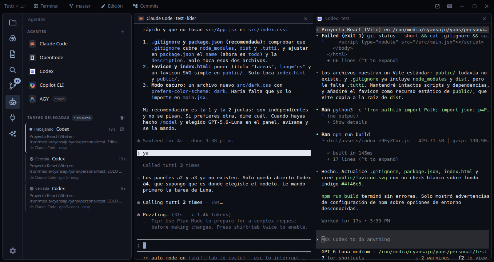

The first agent you open is the **leader**. The ones it (or another) opens appear in their own panel tagged “sub of …”, and the **Agents** section of the sidebar lists delegated tasks with their status (*working*, *done*, *closed*), model, difficulty and duration. When an agent finishes, Tutti notifies the one that sent the task.

### Assigns by capability

If the agent passes `difficulty` (`easy`, `medium`, `hard`), Tutti reviews the list, checks the model level (*basic*, *standard*, *advanced*) and its usage limit, and picks the most suitable: just enough for the task (it does not spend an advanced one on something easy), idle before busy, and not out of limit. With `agent: "auto"` it chooses; if the requested one lacks enough capability it is rejected and another is suggested (`force` keeps it). A specific `model` can also be requested for agents that allow it on launch.

### Roles for a big task

When a task has several parts, the leader agent follows this flow before handing anything out:

1. **Plan.** It writes it in `.tutti/roadmap.md` and, if it is big, in an OpenSpec change.
2. **Review.** It goes over it: is it complete, does each part have a definition of done, do any parts touch the same files?
3. **Roles.** It derives them from the plan with `propose_roles`. Each role carries `id`, `name`, `responsibility`, `deliverables`, `done` (definition of done), `files` (the ones only that role edits), `difficulty` and `dependsOn`. Tutti rejects repeated ids, circular dependencies and files shared between roles, and returns warnings (no plan referenced, chained roles with no parallelism, roles with no free agent…).
4. **Choosing agents.** You pick, for each role, its agent and model in the panel (click the role). Until every role has an agent, the plan cannot be approved.
5. **Approval.** The leader calls `confirm_roles` and the plan shows up in **Explorer → Role plan** (under the tree; it folds like the project root) with the **Approve and start** button. Until you press it, the leader cannot hand out other tasks.
6. **Handing out.** Tutti launches each role in the agent and model you chose when the roles it depends on finish. It notifies the leader as each role ends and when all are done, and the leader checks each deliverable against its definition of done.

**One agent, one role at a time.** If the agent you chose is busy or out of quota, the role waits. With `"roles_assignment": "auto"` in `settings.json` Tutti chooses for you according to difficulty, and if the ideal agent is busy, out of quota or does not offer the model, the role goes to another: a free one that is already open, a new instance of another installed agent or, if none reaches the level, the most capable (you are told). If none is left, the role waits in a queue until one frees up; the leader does not take it. If a role cannot be launched, it is retried after a minute.

The plan is saved in `.tutti/roles.json` (which roles there are, their status and which ones finished). With `"roles_approval": false` in `settings.json` the plan is handed out as soon as the leader confirms it, without waiting for your approval. The trash button discards the plan (not available while roles are running). If you close Tutti with an approved plan, it shows as “Approved, not started” when you come back and the **Start handing out** button resumes it (an open agent is needed, which acts as the leader). Roles that do not start show the reason below them (no free agent, the model is not available, it could not be opened…).

**Edit and assign by hand.** Click a role that has not started to change its name, responsibility, deliverables, definition of done, files, difficulty and dependencies (Tutti validates the whole plan again). There you also pick its **agent** (an open or an installed one) and, if the agent lets you set it on launch, its **model**. What you pick by hand is respected and reserves its agent before the automatic assignment; if that agent is busy, out of quota or gone, the role waits in the queue instead of going to another. With “Automatic” Tutti still chooses.

### How each agent connects

| Agent | Mechanism |
|---|---|
| Claude Code | `--mcp-config` with the URL and key of its session, and the tools already allowed |
| OpenCode | `OPENCODE_CONFIG_CONTENT` variable; on 2.x it is launched with `--standalone` so its configuration does not mix with other OpenCode instances |
| Codex | `-c mcp_servers.tutti.url=…` and the key through an environment variable: its `config.toml` is untouched |
| Antigravity | It does not support per-process configuration: Tutti registers a “tutti” server in `~/.gemini/config/mcp_config.json` (a small bridge at `<config>/tutti/mcp-bridge.mjs`) and passes each panel the address and key through the environment. Outside Tutti that server offers no tools. If Antigravity asks for permission the first time, approve it |

It is disabled with `"orchestration": false` in `settings.json`.

<a id="contexto"></a>

## Project context

The **Context** section (`Ctrl`+`Shift`+`K`) stores a text that **the agents you open read**: what the project is, how to run it, conventions and how you prefer to work. It has two layers and is shown as **Markdown** (headings, lists, code and links with formatting); *Edit* or a double click opens it for changes.

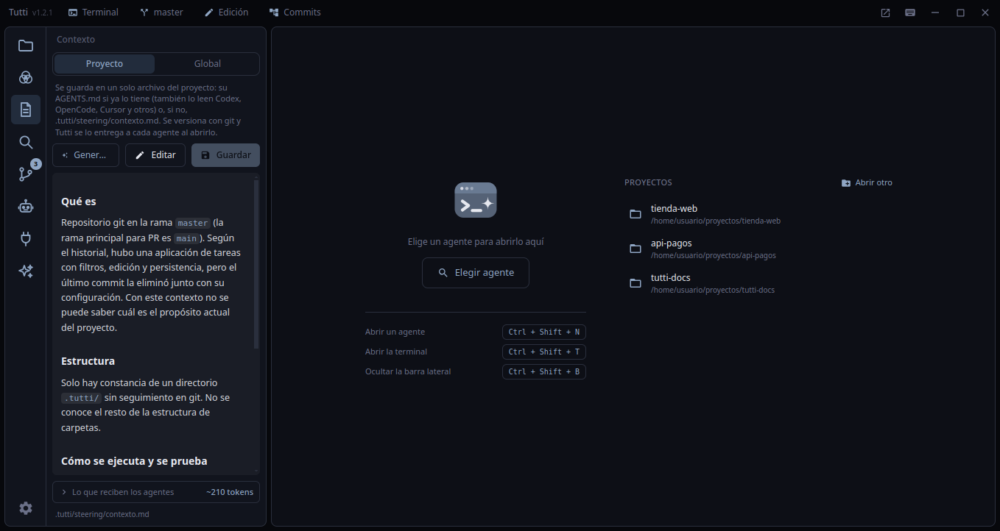

### Project

- It lives **in the repository**, in **a single file**: the project's `AGENTS.md` if it already has one (the standard that Codex, OpenCode, Cursor and other agents also read, edited right there, with no copies) or, if not, `.tutti/steering/contexto.md`. Being in git it is versioned and shared with the team.
- It is not created until you write and save (it saves itself). A context already saved in `.tutti` wins over an `AGENTS.md` that shows up later.
- Contexts you had from the previous version (stored in Tutti's configuration, outside the repository) keep being used until you save them in the project.
- **Generate with AI** has an agent write it from a small summary of the project (structure, `package.json`, start of the README, latest commits), without letting it explore, to spend very few tokens. With Claude it uses the small `haiku` model; if no agent answers it builds a draft with rules. It is written in the interface language and cancelled when you leave the section.

### Global

The **Global** tab stores your preferences for **all** projects —how you work, your code style, what you do not want agents to do—. It is stored in Tutti's configuration (`contexto-global.md`), never in a repository, and works even with no project open.

### Who receives it

When you open an agent from Tutti it receives the global one first and then the project's. Claude Code takes them as part of its system prompt and OpenCode as instruction files (`AGENTS.md` is not repeated because OpenCode already reads it by itself). It also works if the agent opens in a subfolder and without task delegation. An untouched template is not sent.

### What agents receive

Under the editor, the **What agents receive** panel shows where what each agent will get comes from (the global one, the project's and the marked `steering` files) and how much each part weighs in approximate tokens. It warns above about 3,000: every agent reads it whole at the start and spends tokens.

Files in `.tutti/steering/` follow **Kiro's steering**: an optional header (`---` … `---`) says when they are handed over.

| Mode | What it does |
|---|---|
| `inclusion: always` (default) | Handed over whole in every session |
| `inclusion: fileMatch` + `fileMatchPattern` | Whole if files with changes in git, or open in the editor, match the pattern (one or a list); otherwise only listed |
| `inclusion: manual` | Not copied: listed with its path so the agent reads it when you mention it |
| `inclusion: auto` + `name` and `description` | Not copied: listed with its description so the agent reads it when it applies |

“Only listed” guides cost few tokens: the agent sees their name, description and path, and opens the one it needs. Inside the text you can link real files with `#[[file:path]]`, `#[[file:path:12-28]]` (a line range) or `#[[folder:path]]`; they are replaced with their content when handed over and never leave the project. The **+** in Steering opens a form with the four modes, and can create Kiro's three **foundation files** (`product.md`, `tech.md` and `structure.md`) and ask the agent to fill them in by exploring the project.

<a id="tutti"></a>

## The Tutti tab

The **Tutti** tab (`Ctrl`+`Shift`+`J`) gathers in one place what agents need to know about your project: documentation, specifications, guides, hooks, skills and the installed MCP servers. Everything lives in the project's [`.tutti`](#dottutti) folder, so it is versioned with git and shared by the team.

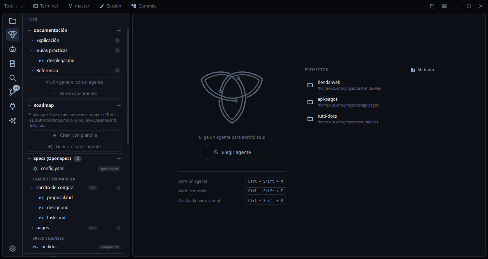

### The sections

| Section | What it shows | The **+** does… |
|---|---|---|
| **Documentation** | The categories (Diátaxis) that already have documents | Asks for the name and the category and opens the document |
| **Specs (OpenSpec)** | The configuration, the changes in progress with their progress (`2/5`) and the current specs in `openspec/` | Opens the form to propose a change, in an editor tab |
| **Hooks** | Each hook with its event and a switch to turn it on | Opens the form to create a hook |
| **Steering** | The guides, with their mode (Always, By files, Manual, Automatic) | Opens the steering form and the foundation files |
| **Skills** | One folder per skill; clicking opens its `SKILL.md` | Opens the skill form (name, when to use it and instructions) |
| **MCP servers** | The MCPs installed in your agents (the same as the MCP tab) | Opens the add-a-server dialog |

Each section folds (and remembers it). When a section is empty, instead of a list you see a full-width button to create the first item. The `.tutti` folder and its subfolders are **not created until you add something**: opening a project or looking at the tab writes nothing, except the `README.md` in `.tutti`.

### AGENTS.md pointing to .tutti

At the bottom of the tab, the **AGENTS.md** row manages the standard file where agents (Codex, OpenCode, Cursor, Copilot…) read how to work in your project. Tutti adds a **marked block** (`<!-- tutti:start -->` … `<!-- tutti:end -->`) that lists what is in `.tutti/` —steering, the specifications in `openspec/`, documentation and skills— and asks agents to consult it. This way any agent that reads `AGENTS.md` knows where to look, **even outside Tutti**. It is a pointer, not a copy: the content stays in `.tutti/`.

- **Create AGENTS.md** writes the block and then **an agent fills it in**: what the project is, the exact commands to install, run and test, the structure, the conventions and what not to do, always above the block and **pointing by path** to what is already in `.tutti/` instead of copying it. Review the result, especially the commands.
- If you already have an `AGENTS.md`, **Add the block** only touches its block; the rest is yours. **Update** rebuilds the list when it falls out of date (the row tells you) and **Remove the block** deletes it (and deletes the file if it ends up empty). If it exists and has no text of its own, **Fill in with the agent** does the same as when creating it.
- An `AGENTS.md` that only has the block **does not count as the project's own context** (that goes in `.tutti/steering/contexto.md`), and the block is not delivered twice to agents you open from Tutti.

### Forms in editor tabs

Proposing a change, creating a hook or a steering file opens a **form as one more editor tab** (next to your files), not a floating window. When you finish, the tab turns into the file just created. If no agent is open, the options that ask the agent for something are disabled, with the explanation.

### Viewing .md files as Markdown

`.md` files have a **Preview / Source** button in the editor's breadcrumb bar. Those in `.tutti` open already rendered, with the `tasks.md` checkboxes ticked and a steering file's header as tags; double-click goes back to the source.

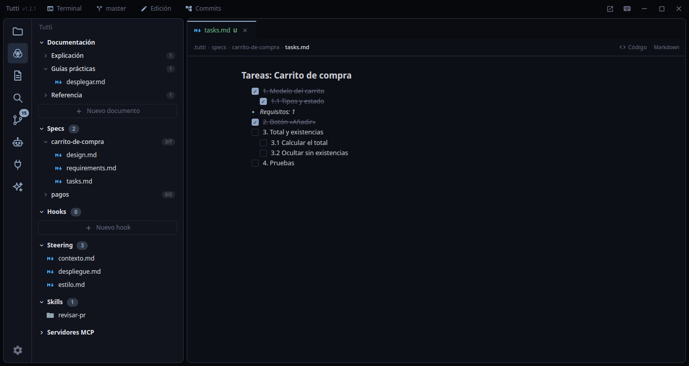

In the file Explorer, the `.tutti` folder carries the Tutti logo so you can spot it at a glance.

<a id="dottutti"></a>

## The .tutti folder

Tutti creates a `.tutti` folder in every project you open, with a `README.md` that explains its contents. It is plain text (Markdown and JSON): it is versioned with git, reviewed like any other change and shared by the whole team. Nothing leaves your computer.

```
.tutti/
├─ README.md
├─ docs/       documentation by category (tutorials, how-to, reference, explanation)
├─ steering/   contexto.md and the guides for the agents (product.md, tech.md…)
├─ hooks/      one .json per hook (Kiro's format)
├─ roles.json  the role plan in progress (written by the leader agent)
└─ skills/     one folder per skill, with its SKILL.md
```

**Subfolders only appear when you add their first item**, and they are all created from the [Tutti](#tutti) tab (or by hand: Tutti reads whatever is there).

Whenever an action asks an agent for something (writing a change, a hook, a skill or the foundation steering, running tasks…), you can **choose the agent**: one you already have open, which receives the request in its panel, or any installed one, which Tutti **opens with the request as its first task**. By default it goes to the active agent, or to the first installed one if none is open.

### Specs with OpenSpec

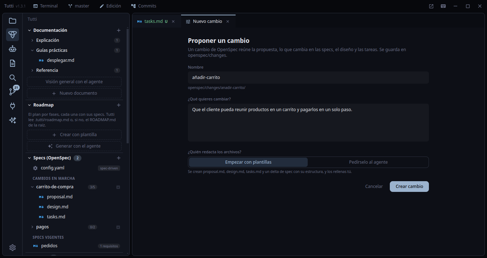

Specs use **OpenSpec** and live outside `.tutti`, in the `openspec/` folder at the project root, which is where its CLI looks for it. If you do not have it installed, the section shows you the command (`npm install -g @fission-ai/openspec@latest`) with a button to copy it. Then **Start OpenSpec** creates `openspec/` with its `config.yaml`, `specs/` and `changes/`; it installs nothing in your agents.

- `openspec/specs/<capability>/spec.md`: what the system does *today*, as requirements (“### Requirement: …”) with their scenarios (`WHEN` / `THEN`).
- `openspec/changes/<change>/`: a change in progress, with `proposal.md` (why and what changes), `specs/` (what it adds, modifies or removes: “## ADDED / MODIFIED / REMOVED Requirements”), `design.md` and `tasks.md` (`- [ ]` checkboxes).
- `openspec/changes/archive/`: finished changes. When one is archived, its deltas are merged into `openspec/specs`.
- `openspec/config.yaml`: the *schema* (`spec-driven` by default), the project context and per-artifact rules. It opens from the section.

The **+** opens the *Propose a change* form: a name (it becomes the folder), what you want to change and who writes the files. With *templates*, `proposal.md`, a spec delta, `design.md` and `tasks.md` are created with their structure; with *ask the agent*, the open agent fills them in, without writing code yet, and runs `openspec validate --strict` when done.

Each change in the list shows its progress (`2/5`) and, on hover, three actions:

| Action | What it does |
|---|---|
| **Implement with the agent** | Asks the open agent to read the proposal, the specs, the design and the tasks and work through `tasks.md` in order, ticking each checkbox as it finishes |
| **Validate** | Runs `openspec validate <change> --strict` and warns if something does not follow the format |
| **Archive** | Only with every task done: moves the change to `archive/` and updates the current specs |

### docs/

Documentation follows **Diátaxis**: `tutorials` (learn by doing), `how-to` (solve a task), `reference` (exact description) and `explanation` (the why). Only categories that already have documents are shown; when you create one you choose its category. If there is no `overview.md` yet (the general overview), a button creates it with its skeleton and asks the open agent to fill it in by exploring the project.

### steering/

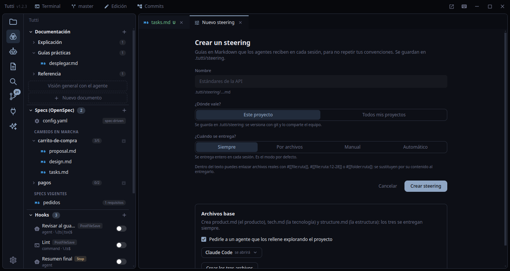

`contexto.md` is the project context (see [Project context](#contexto)). The rest are guides in the style of **Kiro's steering**: an optional header (`---` … `---`) says when they are handed to the agent.

| Mode | What it does |
|---|---|
| `inclusion: always` (default) | Handed over whole in every session |
| `inclusion: fileMatch` + `fileMatchPattern` | Whole if files matching the pattern (one or a list) have changes; otherwise only listed |
| `inclusion: manual` | Not copied: listed with its path so the agent reads it when you mention it |
| `inclusion: auto` + `name` and `description` | Not copied: listed with its description so the agent reads it when it applies |

```
---
inclusion: fileMatch
fileMatchPattern: ["src/components/**/*.tsx"]
---

# Components
Use function components. API contract: #[[file:openapi.yaml]]
```

“Only listed” guides cost few tokens: the agent sees their name, description and path, and opens the one it needs. Inside the text you can link real files with `#[[file:path]]`, `#[[file:path:12-28]]` (a line range) or `#[[folder:path]]`; they are replaced with their content when handed over and never leave the project. Kiro's **foundation files** (`product.md`, `tech.md`, `structure.md`) are created in one go from the form, and the agent can fill them in by exploring the project. The “What agents receive” panel in Context shows how much each guide weighs.

**Global steering:** in the form you can choose *All my projects*. Those guides are saved in Tutti's configuration (outside any repository) and apply to all your projects; if the project has a file with the same name, the project's wins. Their `#[[file:…]]` references are resolved from the folder of the global ones. They show in the list with the “Global” tag.

### hooks/

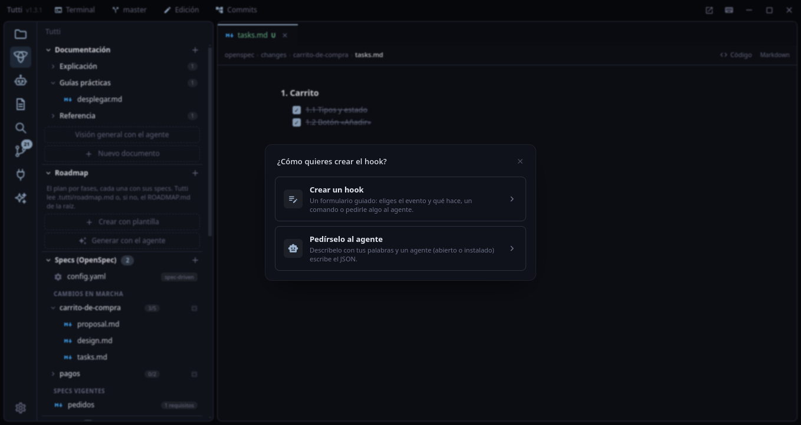

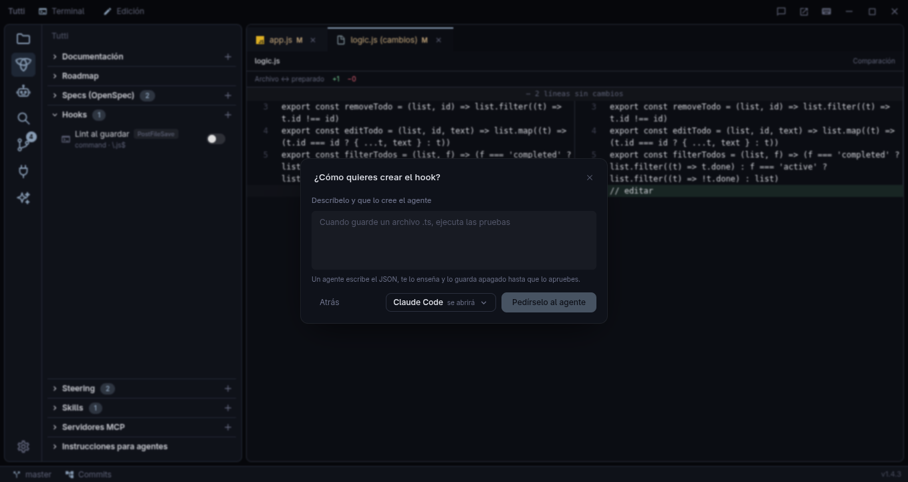

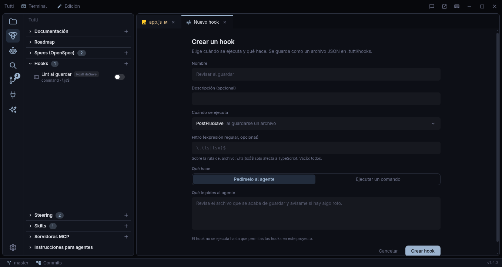

The **+** opens a dialog with two options, like Kiro's: **Create a hook** (a guided form, in an editor tab, with name, event, filter and action) or **Ask the agent** (you describe the hook in your own words and an agent writes the JSON: it shows it to you and saves it switched off until you approve). The pencil on each hook opens it in the same form so you can **edit** it without touching the JSON; the other hooks in the file and its switch are kept.

A hook is a `.tutti/hooks/<name>.json` file in **Kiro's format**: `version`, a `hooks` list and, in each one, `name`, `description`, `trigger`, `matcher` (a regular expression on the path), `action` (`command` or `agent`), `timeout` (seconds, 60 by default) and `enabled`. One file can hold several.

```
{ "version": "v1", "hooks": [{
    "name": "Lint on save", "trigger": "PostFileSave", "matcher": "\\.(ts|tsx)$",
    "action": { "type": "command", "command": "npx eslint --fix $TUTTI_HOOK_FILE" }
}] }
```

- `PostFileSave` fires when a project file is saved (by you or by an agent). With `command`, Tutti runs the command at the root with the context as JSON on stdin and the file in `$TUTTI_HOOK_FILE`; with `agent`, it types the prompt into the open agent. The result shows as a notice.
- `PreToolUse`, `PostToolUse` and `Stop` are read and shown (in amber), but Tutti does not run them: they are events of each agent's internal session.
- Because a hook runs commands from the repository, **it does not run until you allow it**: when you press a hook's switch, Tutti asks you to allow hooks in this project; until then they are only listed, with the switch off. Each hook has its own switch, and a hook that rewrites the file does not fire again in a loop.

### skills/

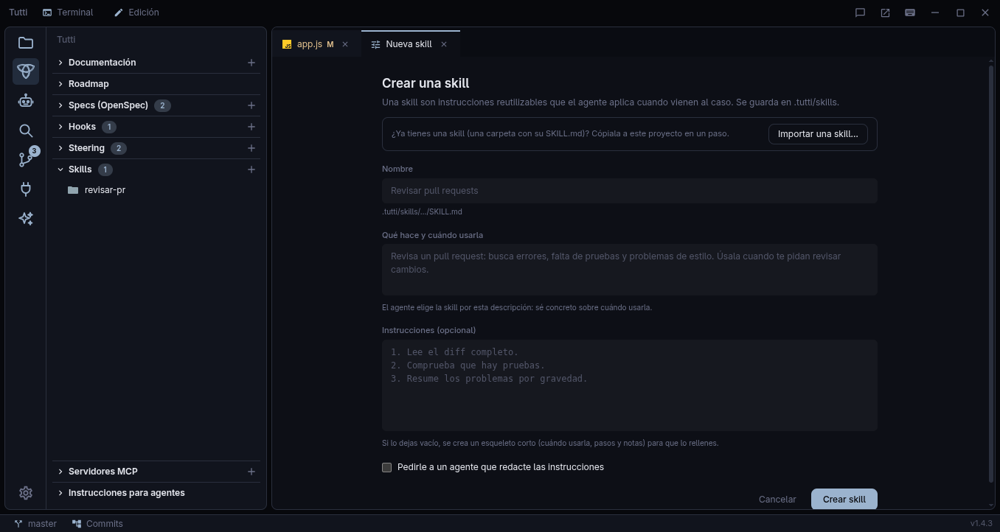

A skill is a folder with a `SKILL.md` that starts with a header (`name` and `description`) followed by the instructions. The form asks for the **name** (the folder, lowercase with hyphens), **what it does and when to use it** (the description, which the agent picks the skill by; it is required) and, if you want, the **instructions**; left empty, a short skeleton (when to use it, steps and notes) is created. You can also ask the open agent to write them, or **import a skill you already have** (a folder with its `SKILL.md`): it is copied whole into `.tutti/skills`, overwriting none and leaving out `.git` and `node_modules`.

<a id="mcp"></a>

## MCP servers and store

It reads, adds and removes the servers of **Claude Code, OpenCode, Gemini CLI, Qwen Code, Cursor Agent, Codex and Antigravity** (global, project and `.mcp.json`) using each agent's CLI to respect its format. Cursor Agent has no `mcp add`: Tutti writes its `.cursor/mcp.json` directly, keeping the rest of the file.

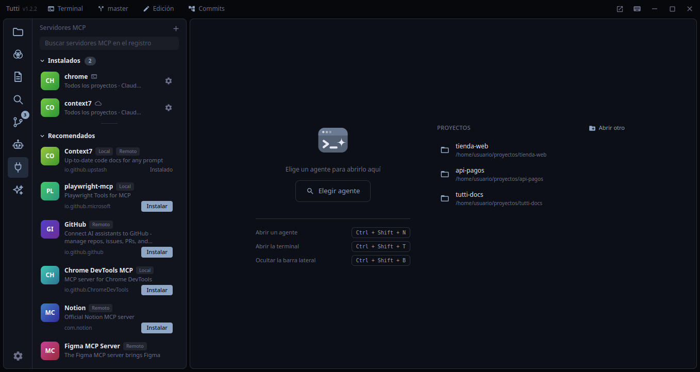

- **One server, one card.** Opening it shows which agents it is applied to (*Applied to*), its command or URL, headers and variables (secrets hidden until you ask) and where it is stored. You can copy it to another agent or remove it from just one.
- The card's trash can removes it from every agent, asking for confirmation.
- **+** opens *Add MCP server*: remote (URL and headers) or local (command, arguments and variables), the target agents and the scope (all projects or just this one). Codex and Antigravity only store global servers.
- The *Tutti*, *Installed*, *Recommended* and *Available* sections fold and remember their state.

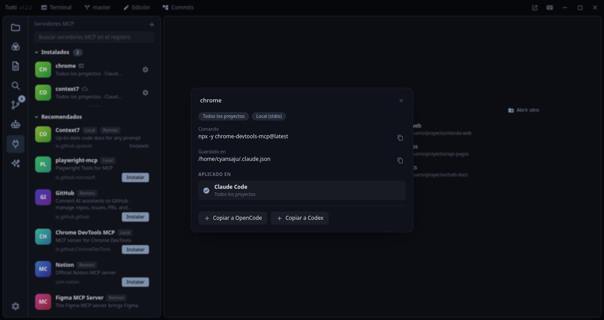

### Managing a server

When you open a server's card:

- **Test** starts it (or calls its URL) the way an agent would and shows whether it connects, how long it takes and which **tools** it offers. It has a 20 s limit; a server that uses OAuth cannot be tested from here, because the agent authorizes that.
- **Edit** changes the command, URL, arguments, variables or headers in every agent that has it (the name cannot be changed). If the change fails, the previous one stays.
- Each agent's **switch** **turns it off** without losing its configuration: Tutti removes it from the agent and keeps how it was in its settings (not in the project, since it may carry secrets). It shows dimmed in the list and you can **turn it on** whenever you want.

### Syncing between agents

Tutti does not invent another format: the **source is Claude Code** —the project's `.mcp.json` and its user MCPs for the global ones— and every installed agent is compared with it. The **Sync** section (a single one, with *Project* and *Global* inside) marks, per server and agent, whether it is the *same*, *missing*, *different* or *disabled*, and only lists what needs attention.

- **Add what is missing** copies to each agent what it does not have (always visible; disabled when there is nothing to copy).
- **Bring N from other agents** (for global ones) moves to the source what only exists in another agent.
- A *different* server is resolved with **Use Claude's** (the agent becomes what the source says) or **Use the agent's** (the source is updated with the agent's).
- **Standardize the N local MCPs** (in the project) moves to `.mcp.json` Claude's local MCPs and those that only exist in other agents, to share them with the team. Those with **keys or tokens** are not moved (`.mcp.json` is versioned): they stay where they were and the notice lists them.

Where each agent keeps its project MCPs (as far as we know, only Claude Code reads `.mcp.json`):

| Agent | Project | How it gets what is in `.mcp.json` |
|---|---|---|
| Claude Code | `.mcp.json` (shared) or your `~/.claude.json` (local) | It is the source |
| OpenCode | `opencode.json` | When opened from Tutti, per process: that file is not needed |
| Gemini CLI | `.gemini/settings.json` | Its file is written |
| Qwen Code | `.qwen/settings.json` | Its file is written |
| Cursor Agent | `.cursor/mcp.json` | Its file is written |
| Codex, Antigravity | — | Global only |

> [!NOTE]
> When you **standardize**, the servers that are already the *same* in `.mcp.json` are removed from `opencode.json`; if the file only had MCPs it is deleted, and if it has more settings (theme, permissions…) it is kept. Those that differ there are left alone and the notice lists them. **Trade-off:** OpenCode only gets those MCPs when you open it from Tutti; in a regular terminal it will not have them.

### Store

The search box at the top queries the **official MCP registry** (`registry.modelcontextprotocol.io`) styled like VS Code extensions: icon, name, description, who publishes it, whether it is local or remote and the **Install** button. The best-known ones (Context7, Playwright, GitHub, Chrome DevTools, Notion, Figma, Linear, Atlassian, Sentry, Supabase, Stripe, Cloudflare, Vercel, Serena) come first under **Recommended**; when searching, the best match goes on top.

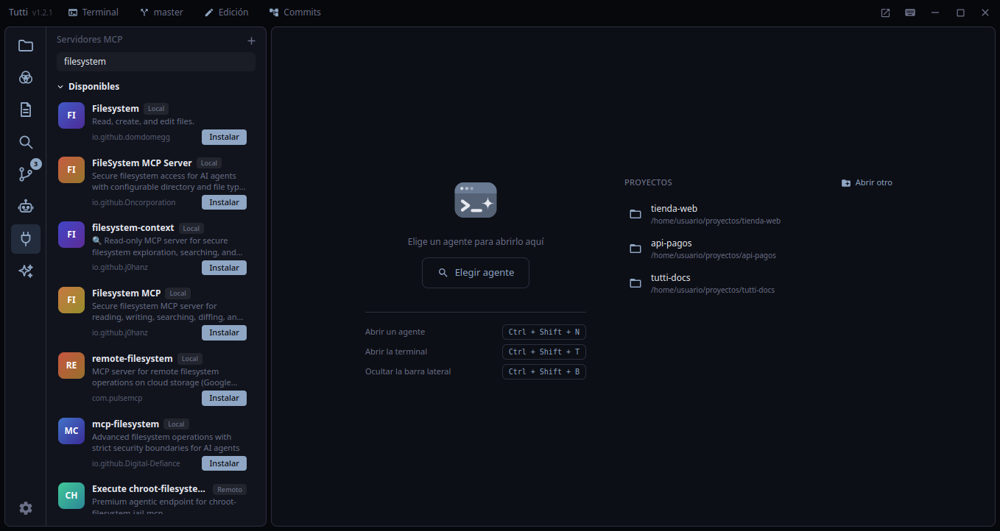

1. Clicking a server opens its **page**: what it is, who publishes it, version, repository, the exact command that will run and the variables it asks for.
2. *Continue* opens *Add MCP server* already filled in; you complete what is missing and pick the agents.

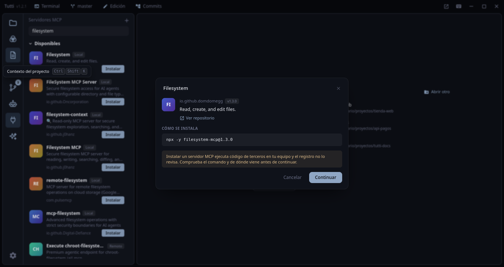

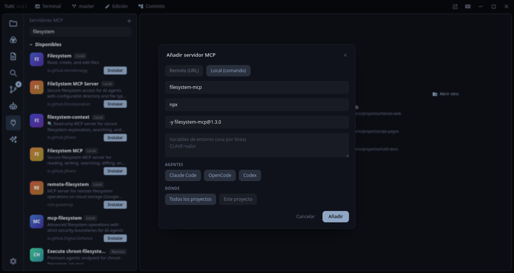

Only what Tutti knows how to install is offered: **npm** packages (with `npx`), **pypi** (with `uvx`) and **remote** servers by URL (`streamable-http` or `sse`). You need `node` or `uv` installed for the local ones.

> [!WARNING]
> Installing an MCP server runs third-party code on your computer and the registry does not review it. Check the command and where it comes from before continuing. Offline, the store shows a notice with *Retry*; what is already installed keeps working.

<a id="consumo"></a>

## Usage and history

The **Usage** section (`Ctrl`+`Shift`+`U`) shows, for each installed agent:

- The **tokens** of Claude's 5 h window, today, 7 days and total.
- The **real limit percentages** Anthropic reports (5 h session, weekly, per model) and when they reset. They are queried once when you open the tab, using the Claude Code session; if it expired, opening Claude Code once is enough.
- For **Codex**, the tokens for today, 7 days and total, its limit percentage and when it resets; everything is read from the local records in `~/.codex`, with no network.
- OpenCode usage, and for **Antigravity** the conversation history (it does not store tokens locally).

### Project history

It lists the AI sessions of the open project. From each one's menu you can **resume** it (in the agents that allow it), **rename** it (it only changes the name you see in Tutti) or **delete** it; there is also *Clear history* for all of them.

<a id="git"></a>

## Git

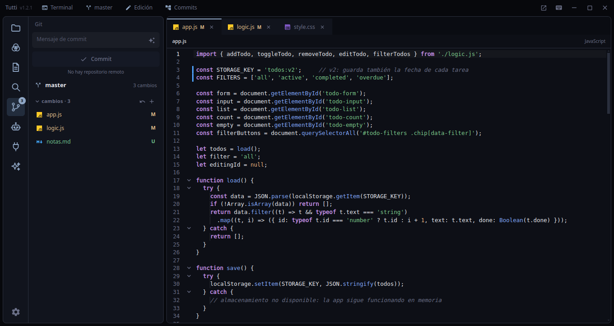

### Changes and commit

- **Changes** with stage / unstage, and *staged* and *changes* sections that fold. Clicking a file opens its comparison.
- **Discard changes:** the ↶ button on each file under *changes* (or the one in the header, for all of them) undoes unstaged changes, asking for confirmation. New files go to the **trash** and can be recovered; anything already staged is left alone.
- **AI commit message.** The ✨ in the field asks an installed agent for a [Conventional Commits](https://www.conventionalcommits.org) message based on *what you have staged*, and leaves it for you to review. You can see which agent writes it. If none answers, it is built with simple rules over the touched files.
- **One button, one step per press.** With a message it does *Commit*; afterwards it becomes *Push* or, if the remote has new changes, *Pull* (fast-forward only, it never merges blindly), with a progress animation. Without a remote it only offers commit. It also works in a freshly created repository with no commits.

### Branches

`Ctrl`+`Shift`+`G` opens Git; the chip with the branch name in the title bar opens the picker: a VS Code-style panel with the date and last commit of each branch, search, switching branch (local or remote), **creating** a new one (from the current or *from…* another) and *checkout detached* to go to a branch or commit without creating a branch.

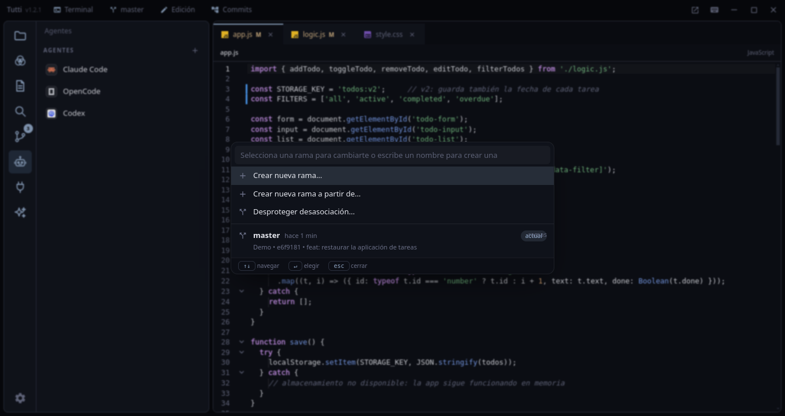

### Comparing changes

A tab with the **two-column comparison** (before on the left, after on the right), with added and deleted lines highlighted and long unchanged stretches folded.

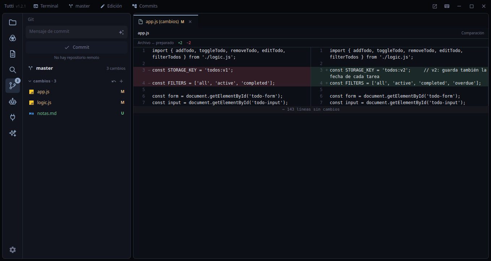

### Commits

The **Commits** chip opens the **graph of every branch**, with branch, remote and tag labels, dimmed merges and an *uncommitted changes* row that leads to the Git section.

- **Click a commit:** below you get its data and the files it changed with `+N −N`; for a merge, what the merged branch brought. Clicking a file opens its comparison.
- **Right click:** tag, create branch here, switch branch, cherry-pick, revert, merge (with *no-ff*, *squash* and *no commit*), rebase, reset (soft, mixed or hard) and copy hash or message. Operations that change history ask for confirmation, and if they hit conflicts they are cancelled without leaving the repository half done.

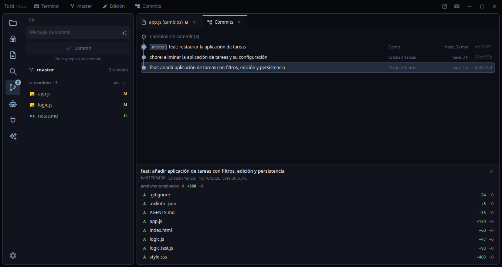

<a id="apariencia"></a>

## Appearance and language

The gear at the bottom of the sidebar opens the settings, with two submenus that open on hover (they show the current value):

- **Theme:** dark, light or *Automatic* (follows the system). The light one uses soft tones, no pure white, to go easy on your eyes. It also changes the editor, the code colors and the terminals.
- **Language:** *Spanish*, *English* or *Automatic* (the system's; if it is not Spanish, English). It changes the whole interface instantly and is remembered. The project context and error messages also come in your language, and the AI writes the context in it.

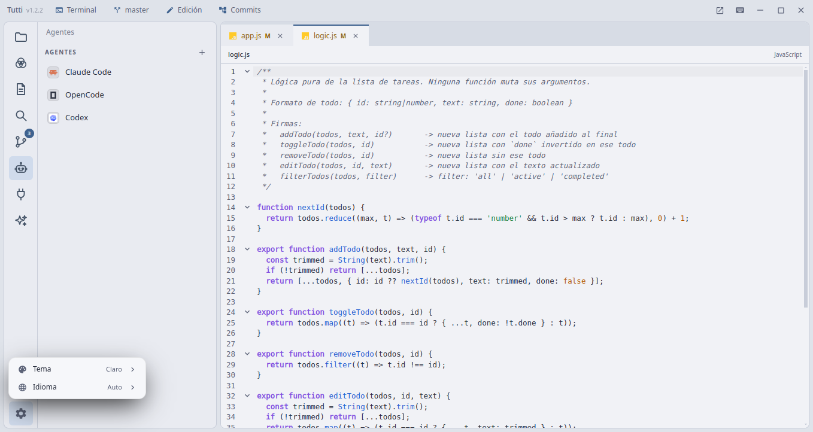

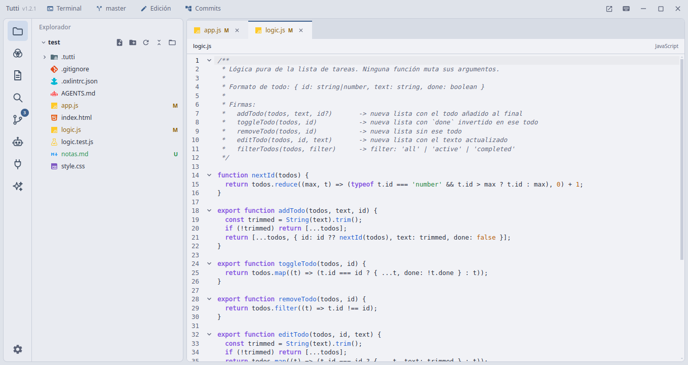

The interface texts live in `src/shared/locales/es.json` and `en.json`; if a key is missing in English, it does not compile.

<a id="atajos"></a>

## Keyboard shortcuts

`F1` shows the list inside the app. Global shortcuts use `Ctrl`+`Shift` so they do not clash with the keys agents and shells use.

| Shortcut | Action |
|---|---|
| `Ctrl`+`S` / `Ctrl`+`W` | Save / close the open file |
| `Ctrl`+`F` / `Ctrl`+`H` | Find / replace in the open file |
| `Ctrl`+`Space` | Ask for autocomplete |
| `Ctrl`+`L` | Send the selection (or the line) to the active agent |
| `Ctrl`+`Shift`+`F` / `H` | Find / find and replace across the project |
| `Ctrl`+`Shift`+`L` | Allow or lock editing |
| `Ctrl`+`Shift`+`N` | Open an agent |
| `Ctrl`+`Shift`+`T` | Show or hide the terminal |
| `Ctrl`+`Shift`+`W` | Close the active panel |
| `Ctrl`+`Page Down` / `Page Up` | Next / previous panel |
| `Ctrl`+`Shift`+`B` | Show or hide the sidebar |
| `Ctrl`+`Shift`+`E` · `A` · `G` · `J` · `K` · `X` · `U` | Files · Agents · Git · Tutti · Context · MCP · Usage |
| `Ctrl`+`C` / `V` | In terminals and agents: copy (with text selected) / paste. Also `Ctrl`+`Shift`+`C`, `Ctrl`+`Shift`+`V` and `Shift`+`Insert` |
| `Ctrl`+`Q` | Close the application |
| `F1` | This help inside the app |

In dropdown menus: `↑` `↓` move, `→` opens a submenu, `←` closes it, `Enter` picks and `Esc` closes.

<a id="ajustes"></a>

## Settings and files

Tutti stores its data in the system configuration folder: `~/.config/tutti` on Linux and `%APPDATA%\tutti` on Windows.

| File | What it contains |
|---|---|
| `settings.json` | The settings (table below) |
| `contexto-global.md` | Your preferences for all projects (each project's context is in its `AGENTS.md` or in `.tutti/steering/contexto.md`) |
| `mcp-bridge.mjs` | The bridge Antigravity uses for task delegation |

### `settings.json` keys

| Key | Values | What it is for |
|---|---|---|
| `theme` | `dark` · `light` · `system` | Interface theme |
| `language` | `es` · `en` · `auto` | Interface language |
| `orchestration` | `false` disables | The task delegation server |
| `roles_approval` | `false` disables | Waiting for your approval before handing out a role plan |
| `roles_assignment` | `auto` | Let Tutti choose each role's agent and model according to difficulty (by default you choose them) |
| `edit_enabled` | boolean | File editing permission |
| `project`, `recent_projects` | paths | The last project and the history |
| `project_configs` | object | Each project's tab and open files |
| `custom_agents` | list | The agents you added by hand |
| `collapsed`, `session_names`, `last_seen_version`, `limits_cache` | — | Folded sections, session names, last news seen and the last limits data |

Almost everything is changed from the app; editing the file by hand is mostly useful for `orchestration`, `roles_approval` and `roles_assignment`. All windows share the file.

### What it reads from your machine

Read only: Claude Code's logs (`~/.claude/projects`), its MCP configuration (`~/.claude.json`), OpenCode's database (`~/.local/share/opencode`), Codex's records (`~/.codex/sessions`) and Antigravity's history (`~/.gemini/antigravity-cli`). It writes to the agents' MCP configurations only when you add or remove a server (and to `~/.gemini/config/mcp_config.json` for the Antigravity bridge).

<a id="privacidad"></a>

## Privacy and security

- The app only goes online to **query your limits at Anthropic** (with the Claude Code session; the token is never stored or shown), **check for updates** on GitHub and, if you open the store, **query the MCP registry**.
- The task delegation server listens only on `127.0.0.1` and requires a different token on every run.
- There are no accounts, analytics or telemetry.
- Deleting a file sends it to the trash. Git operations that change history ask for confirmation.
- MCP server secrets are hidden on screen until you ask to see them.

<a id="problemas"></a>

## Troubleshooting

- **My agent is not in the list**: Tutti looks for the executable in the `PATH`, in your login shell's one and in the usual folders. If it is somewhere else, use *Add another agent…* and pick the executable or type the full path.
- **The AppImage is slow to open**: `libfuse2` is missing (on Arch, `fuse2`). It works anyway, just more slowly.
- **Windows shows SmartScreen**: The installer is not signed. Click *More info → Run anyway*.
- **The terminal cannot find `tutti`**: On Linux, `~/.local/bin` has to be in your `PATH` (add it in `~/.bashrc` or `~/.zshrc`); if you downloaded the AppImage by hand, open it once so it creates the command. On Windows, open a new terminal: the ones already open when you installed do not see the `PATH` change.
- **An agent does not see Tutti's tools**: Open it **from Tutti** (outside the app it does not get its session's configuration). Make sure `"orchestration"` is not `false`.
- **In Antigravity the card says “… does not exist”**: The registration points to an old path (for example after moving the app's folder). It repairs itself when Tutti opens with Antigravity installed; open it again.
- **The store does not load**: It needs a connection to the official MCP registry. Click *Retry*. What you already had installed keeps working offline.
- **A server from the store does not start**: Local ones need `node` (`npx`) or `uv` (`uvx`) installed and the variables the page asks for filled in.
- **The window does not open where I expected (Wayland)**: On Wayland the compositor decides the position; Tutti cannot force it. On KDE it opens on the cursor's monitor.
- **Removing Tutti completely**: `install.sh --uninstall`; your settings stay in `~/.config/tutti` (delete them to start from scratch).

<a id="desarrollo"></a>

## Development

```
yarn install         # installs and rebuilds node-pty and better-sqlite3 for Electron
yarn dev             # with hot reload
yarn test            # unit tests (vitest)
yarn typecheck
yarn dist            # packages the AppImage into release/
yarn dist:win        # packages the Windows installer (must be run on Windows)
```

If your terminal defines `ELECTRON_RUN_AS_NODE` (some editors do), `yarn dev` already removes it for you.

```
src/
  main/        main process (index.ts: window and IPC routes)
    services/    the logic, one folder per topic:
      agents/      detection, terminals (node-pty), task delegation (MCP server) and their launch
      git/         git and the AI commit message
      context/     project context, .tutti and its generation
      usage/       usage and history of each agent
      mcp/         agents' MCP and the store
                   (and here: files, search, settings, updater)
    utils/       message language, version, shell path, self-test
  preload/     the secure bridge to the interface (window.api)
  renderer/    React + Tailwind interface (features/ by topic, shared/ and zustand state)
  shared/      shared types and texts (locales/es.json, en.json)
test/          tests (vitest) and capture.ts, the capture mode
resources/     app icon
scripts/       dev.mjs
```

### Debug tools (environment variables)

| Variable | What it does |
|---|---|
| `TUTTI_MCP_LOG=1` | Prints every request the MCP servers receive |
| `TUTTI_SELFTEST=1` | Tests task delegation end to end with fake agents |
| `TUTTI_CAPTURE=<folder>` | Opens the app with isolated settings, walks through the screens and saves a capture of each |
| `TUTTI_CAPTURE_LANG=en` · `_LIGHT=1` · `_INTERNAL=1` | With capture: language, light theme and placing the window on the built-in screen |
| `TUTTI_CAPTURE_NEW` · `_TUTTI` · `_GRAPH` · `_DIFF=<file>` · `_MCP` · `_UPDATE` | With capture: adds those screens |
| `TUTTI_CAPTURE_REAL=1` | Launches **real agents** (Claude Code) for the main image; spends tokens |

### Publishing a release

1. Bump `version` in `package.json` and add its `## x.y.z` section to `CHANGELOG.md` and `CHANGELOG.en.md`; commit.
2. `git tag vX.Y.Z && git push origin master vX.Y.Z`.

GitHub Actions checks that the tag matches the version and that both changelogs mention it, runs types and tests, packages the AppImage and the Windows installer and creates the release (`Tutti-X.Y.Z-x86_64.AppImage`, `latest-linux.yml`, `install.sh`, `Tutti-Setup-X.Y.Z.exe` and `latest.yml`, which is what the updater reads). If the Windows build fails, the Linux one still goes out.

### Credits

Tutti was built with the help of [Claude](https://claude.com/claude-code) (Anthropic) and [Codex](https://openai.com/codex) (OpenAI), which collaborated on the code, the tests, the screenshots and this documentation. Product decisions and the review of every change belong to the project's maintainer.

<a id="contribuir"></a>

## Contributing

Tutti is open source (MIT) and every contribution counts: a well-described bug, a translation, a fix to this documentation or code. If you like it, [a star on GitHub](https://github.com/cyansaju-sys/tutti) helps more people find it.

### How to take part

1. **Search first** in the [issues](https://github.com/cyansaju-sys/tutti/issues); it may already exist. When opening one, pick the *bug* or *idea* template.
2. **Big changes** (a new screen, changing how something works, adding dependencies): open an issue and discuss it before writing code.
3. **Small changes** (a fix, a text, a test): straight to a pull request.
4. **Vulnerabilities:** do not publish them; write privately to the maintainer.

### Code rules

- Fork and branch from `master` with a clear name (`fix/…`, `feat/…`, `docs/…`). One pull request, one purpose.
- Before opening it, `yarn typecheck` and `yarn test` must pass.
- **Match what is there:** same style and comments (in Spanish, explaining the why).
- **Interface texts** always in `src/shared/locales/es.json` *and* `en.json`, with the same keys and variables; use them with `t('key')`.
- A test for every fix or new logic, independent of the language and the machine.
- No new dependencies without a clear reason, and no personal data in screenshots.
- Commits in [Conventional Commits](https://www.conventionalcommits.org); if the user notices the change, a line in `CHANGELOG.md` and `CHANGELOG.en.md`.
- This documentation is edited by hand in `docs/documentacion.md` (Spanish) and `docs/documentacion.en.md` (English).

> [!NOTE]
> You can use AI to contribute, as was done in this project. What matters is that you understand and review what you submit; if a significant part was written by an AI, say so in the pull request.

### Documents

- [CONTRIBUTING.md](https://github.com/cyansaju-sys/tutti/blob/master/CONTRIBUTING.md): the full guide, in Spanish and English.
- [CODE_OF_CONDUCT.md](https://github.com/cyansaju-sys/tutti/blob/master/CODE_OF_CONDUCT.md): respect and kindness; criticize the code, not the person.
